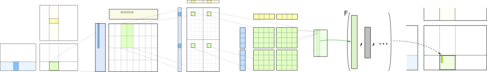
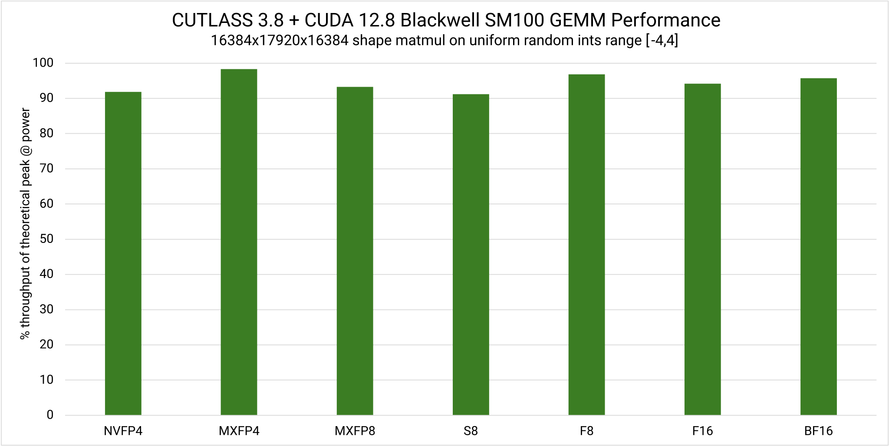
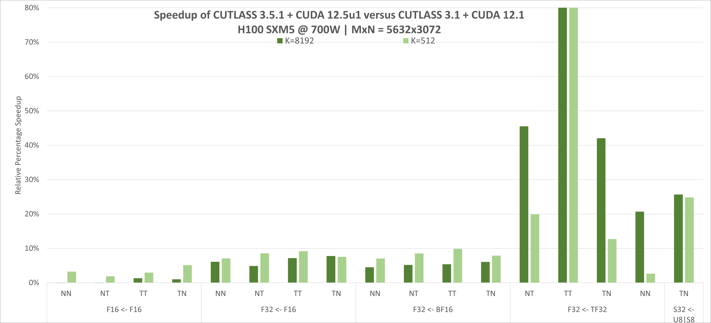
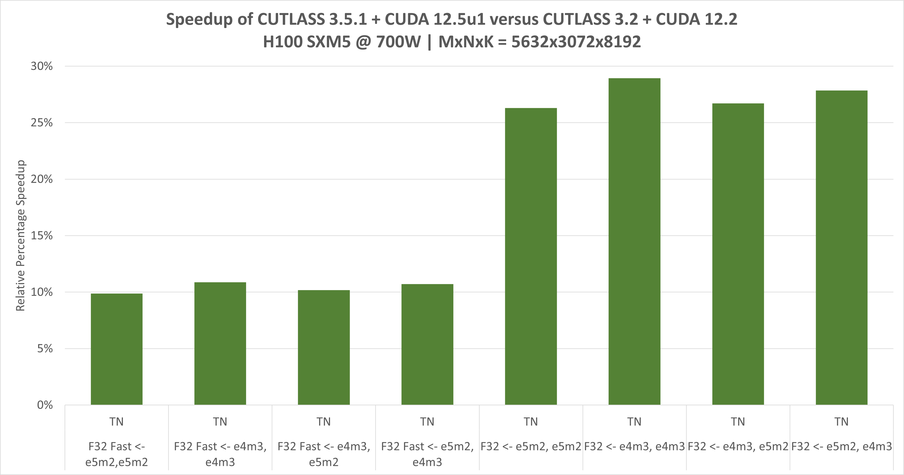

# Overview

# CUTLASS 4.9.0

_CUTLASS 4.9.0 - Nov. 2026_

CUTLASS is a collection of abstractions for implementing high-performance matrix-matrix multiplication (GEMM)
and related computations at all levels and scales within CUDA. It incorporates strategies for
hierarchical decomposition and data movement. CUTLASS decomposes these "moving parts" into reusable, modular
software components and abstractions.

Primitives for different levels of a conceptual parallelization hierarchy can be specialized and tuned
via custom tiling sizes, data types, and other algorithmic policy. The resulting flexibility simplifies
their use as building blocks within custom kernels and applications.

CUTLASS has been providing CUDA C++ template abstractions for high-performance linear algebra since 2017 and
these abstractions provide extensive support for a wide range of computations including
mixed-precision computations, specialized data-movement (async copy) and
multiply-accumulate abstractions for FP64, FP32, TF32, FP16, BF16,
[FP32 emulation via tensor core instruction](https://github.com/NVIDIA/cutlass/tree/main/examples/27_ampere_3xtf32_fast_accurate_tensorop_gemm),
 8b floating point types (e5m2 and e4m3),
 block scaled data types (NVIDIA NVFP4 and OCP standard MXFP4, MXFP6, MXFP8),
 narrow integer types (4 and 8b signed and unsigned integers),
 and binary 1b data types (where architectures allow for the
native support of such data types) across NVIDIA's Volta, Turing, Ampere, Ada, Hopper, and Blackwell architectures.

To this rich ecosystem of C++ based kernel programming abstractions, CUTLASS 4 adds CUTLASS DSLs. These are Python native interfaces for writing high-performance CUDA kernels based on core CUTLASS and CuTe concepts without any performance compromises. This allows for a much smoother learning curve, orders of magnitude faster compile times, native integration with DL frameworks without writing glue code, and much more intuitive metaprogramming that does not require deep C++ expertise.

Overall, we envision CUTLASS DSLs as a family of domain-specific languages (DSLs). With the release of 4.0, we released the first of these in CuTe DSL. This is a low-level programming model that is fully consistent with CuTe C++ abstractions - exposing core concepts such as layouts, tensors, hardware atoms, and full control over the hardware thread and data hierarchy.

CuTe DSL demonstrates optimal matrix multiply and other linear algebra operations
targeting the programmable, high-throughput _Tensor Cores_ implemented by
NVIDIA's Ampere, Hopper, and Blackwell architectures.

We believe it will become an indispensable tool for students, researchers, and performance
engineers alike - flattening the learning curve of GPU programming, rapidly prototyping kernel
designs, and bringing optimized solutions into production.

CuTe DSL is currently in public beta and will graduate out of beta by end of summer 2026.

To get started quickly - please refer :
  - [CUTLASS C++ Quick Start Guide](https://docs.nvidia.com/cutlass/latest/media/docs/cpp/quickstart.html).
  - [CuTe DSL Quick Start Guide](https://docs.nvidia.com/cutlass/latest/media/docs/pythonDSL/quick_start.html).

# What's New in CUTLASS 4.9
## CuTe DSL
* New features:
  - Additional Rubin support focused on low-latency kernels and FP6 throughput.
    - C++ adds support for TMA load with validity reporting.
    - CuTe DSL/CuTe DSL extensions adds support for TMA loads with validity reporting and 2:4 structured sparsity for FP4 MMA.
    - CuTeDSL extensions now supports automatic preferred/fallback cluster shape launch without DSL code duplication.
    - CuTeDSL extensions pipelines support new Rubin tcgen05 commit variant to release A operand early.
    - Primitives adds TMA loads with validity reporting, 2:4 structured sparsity for FP4 MMA, shared-memory ring buffers, early A-stage release, and densely packed FP6 MMA (K=64). 
  - CuTe DSL extension APIs can now be used directly with `@cute.jit`, `@cute.kernel`, and `cute.compile` without an opt-in flag. Programs that do not require extension APIs can select the previous compiler path with `CUTE_DSL_USE_EXTENSION_COMPILER=0` or, per compilation, `cute.compile[cute.DisableCuteExtCompile](...)`.
  - Expanded preferred/fallback cluster-shape support across Blackwell and Rubin GEMM examples.
  - print_tmem_tensor` is now available to inspect the TMEM tensors. This initial implementation only supports 32-bit dtypes.
  - Improved JAX support:
	- Support for `jax.vmap` with with `cutlass_call`
  	- Support CuTe DSL extensions kernels that automatically provision workspaces
    - Support for dynamic host arguments and casting
    - Reduce CPU overhead in launching JAX kernels
  - The % and // operators are migrating toward Python semantics. Use `options="--divmod-semantics=python"` to select Python floor-division and modulo semantics, or `options="--divmod-semantics=legacy"` to retain the previous behavior. Legacy semantics remain the default, with migration warnings for potentially affected code. We will make Python semantics the default in a future release.
  - Epilogue Fusion Configuration (EFC) for dense GEMM, in `examples/python/CuTeDSL/helpers/efc`:
    - Gated linear units fused onto a single MMA: `efc_config.accum_split(num_parts)` splits the accumulator into N-interleaved parts, and `swiglu()`, `geglu()`, `reglu()` and `gated(name)` compute `up * activation(gate)` from a two-way split. The output is `num_parts` times narrower along N than the accumulator and is stored through TMA.
    - Block-scaled MXFP8 operands on Blackwell with `DenseGemmEFCBlockScaled`: fp8 A/B with E8M0 scale factors per 32 K elements, Float32 accumulator, tile N of 64, 128, 192 or 256.
    - Rubin support with `DenseGemmEFCSm107` (fp8 with the K=64 MMA and B collector reuse) and `DenseGemmEFCBlockScaledSm107`.
    - `DenseGemmEFC` takes `swizzle_size` and `raster_along` for the persistent tile scheduler; the EFC examples expose them as `--swizzle_size` and `--raster_order`.
    - Tensors using direct global-memory transport no longer require the problem size to be a multiple of the tile shape.
    - Shared-memory and tensor-memory capacities are queried for the compilation target.
    - Not listed in earlier release notes: per-tensor transport selection for `tensor.load()` / `tensor.store()` (TMA, direct global-memory access since 4.6, `cp.async` load since 4.7) and reductions with `tensor.reduce(value, op=...)` (scalar since 4.6, per-row and per-column since 4.7).

* New example kernels added:
 - CuTe DSL:
    - Adds distributed JAX + NCCL4Py examples
    - Adds Rubin dense GEMM kernel using new TMA validity reporting instruction to do low-latency, fine-grained, data-driven synchronization between kernels
 - CUTLASS Primitives: 
    - Rubin FP4 GEMM 
    - Rubin FP8 GEMM for low-latency use cases
    - Blackwell FP16/BF16/TF32/FP8 Implicit GEMM Fprop Conv
 - CuTe extensions:
    - Adds Rubin dense GEMM kernel using new TMA validity reporting instruction to do low-latency, fine-grained, data-driven synchronization between kernels
    - Blackwell examples for fixed-sequence-length FMHA prefill and persistent mixed-input GEMM
    - Rubin GEMM demonstrating split A/B TMA load pipelines with new tcgen05.commit variant.
    - Rubin FP4 sparse blockscaled GEMM with 2:4 sparsity

* Bug fixes and improvements:
  - Breaking correctness fix: fixed TMA descriptor races in `cute_ext` grouped GEMM and pointer-array GEMM kernels by requiring explicit updates for device-dynamic TMA tensors. Affected 4.8 kernels must now call `tensor = cute_ext.tma_update(tensor)` after construction and after reconstruction with changed pointer, shape, or strides. Execute the update on the warp issuing the consuming TMA operations and use the returned tensor; implicit updates could execute on multiple warps. The affected examples have been updated in 4.9.
  - `epilogue_tma_store` no longer drains the TMA-store pipeline on return, allowing stores to overlap across persistent tiles. Callers must call `tail()` after their final store-producing epilogue invocation.
  - `import cutlass.cute` is about 25% faster. Import is most of the time it takes to get a first compiled kernel. NumPy is now lazily imported when a dense elements attribute (`F64`/`I32`/`I64`/`IndexElementsAttr`) is built from Python values.
  - CUTLASS Primitives' `tensormap_replace` now keeps device-side TMA descriptor updates safe when a descriptor is shrunk below its original extent (e.g. grouped GEMM) and fixes a possible illegal memory access on Blackwell/Rubin.  This behavior can be opted out by specifying `keep_oob_fetch_window=True`. See https://docs.nvidia.com/datacenter/tesla/tesla-release-notes-595-91-07/index.html#known-issues for more details on the known `cuTensorMapEncodeTiled` bug.
  - EFC `gelu` now uses the erf form and matches `torch.nn.functional.gelu`; it previously used the tanh approximation. `silu` and `gelu` evaluate narrow inputs in Float32 and round once, which fixes inaccurate float16 results.
  - EFC reductions now fold and accumulate in the destination tensor's data type, which must be 32-bit wide.

* Documentation updates:
    - Updated the CUTLASS Python [deprecation policy](https://docs.nvidia.com/cutlass/latest/media/docs/pythonDSL/deprecation.html). A deprecated API is now removed no earlier than four minor releases after the release that deprecated it, instead of the following minor release. Breaking changes (e.g. removing an API without an alternative) will only occur at a major version change.
    - A deprecation goes through `silent`, `warn once`, `warn once per call site`, `warn every call`, and then `removed`, so its warning gets louder as removal approaches. A deprecation that does not warn yet starts its four-release window in the release that turns its warning on.
    - Deprecation warnings are now shown by default, including for kernels that live in a package. Python by itself shows `DeprecationWarning` only for code in `__main__`. Each warning is a `cutlass.DSLDeprecationWarning`, a subclass of `DeprecationWarning`, and names the line in your code that uses the deprecated API.

* Installation changes:
  - The IKET host profiler (`run-iket`) is now optional and provided by the separate `nvidia-cutlass-dsl-tools` package.
    - Previously: `pip install nvidia-cutlass-dsl` included IKET.
    - Now: `pip install "nvidia-cutlass-dsl[tools]"` installs the DSL and matching IKET tools.
    - For CUDA 13: use `pip install "nvidia-cutlass-dsl[cu13,tools]"`.
    Existing `run-iket` usage is unchanged. Users who do not need IKET can continue installing `nvidia-cutlass-dsl` without the `tools` extra.

* Known issues:
  - Due to a bug in CUDA toolkit, the use of some packed instructions result in invalid code generation.  Given the nature of the instructions and how they are explicitly used, we have chosen to not silently rewrite these, but rather are flagging until the upstream compiler fixes are available.
    - Avoid packed higher-throughput FP8 (MMA_K=128)4×FP8 subtraction via inline PTX `sub.rn.e4m3x4.e4m3x4` or `sub.rn.e5m2x4.e5m2x4`, as incorrect code generation can produce wrong results.
    - Some CUTLASS Primitives packed mixed-input ops compile incorrectly on Rubin (sm107a/sm107f), resulting in wrong code generation. The specific patterns include:
      - Packed mul, sub, and add ops with bf16x2 or fp16x2 result type and f32x2 input type when result is converted to fp32 later. APIs affected: `add_packed_f16x2_f32x2_f32x2`, `add_packed_bf16x2_f32x2_f32x2`, `mul_packed_f16x2_f32x2_f32x2`, `mul_packed_bf16x2_f32x2_f32x2`, `sub_packed_f16x2_f32x2_f32x2`, `sub_packed_bf16x2_f32x2_f32x2`
        - For example:
  	   '''
          x = prims.mul_packed_bf16x2_f32x2_f32x2(a, b)
          out[0], out[1] = f32(x[0]), f32(x[1])  # out[0], out[1] are wrong
          ```
      - Packed mul op with bf16x2 or fp16x2 result type and mixed bf16x2 and fp16x2 input types when the first operand is a compilation-time constant. APIs affected: `mul_packed_bf16x2_bf16x2_f16x2`, `mul_packed_f16x2_f16x2_bf16x2`
        - For example: 
   ```
   x = prims.mul_packed_bf16x2_bf16x2_f16x2(2.0, b) # x is wrong 
   x = prims.mul_packed_f16x2_f16x2_bf16x2(2.0, b)  # x is wrong
   ```
  - `cute.tile_to_shape` and similar layout algebra may have dynamic strides folded to 0 when the shape is 1 within device code and not within host code. Previously this kind of folding behaviour was default in the CuTe extensions compiler, but did not occur in CuTe programs. Users should avoid relying on strides of modes whos extents could fold in this way or opt out of the CuTe extension compiler for effected programs with `compiled = cute.compile[cute.DisableCuteExtCompile](launch_fn, *args)` or `CUTE_DSL_USE_EXTENSION_COMPILER=0 python your_program.py` see the known issues document for more information.
  - TMA descriptor prefetches on CuTe atoms will be hoisted to warp 0. To opt out use `compiled = cute.compile[cute.DisableCuteExtCompile](launch_fn, *args)` or `CUTE_DSL_USE_EXTENSION_COMPILER=0 python your_program.py`. The team is actively working towards a fix by 4.9.0.

* This release has been tested against the following packages:
  - FlashAttention: [main (2ed4a1f)](https://github.com/Dao-AILab/flash-attention/commit/2ed4a1f0fc0e36a6ca7b861bfbf86ebb82c4c592)
  - Quack: [main (bb0e6b22)](https://github.com/Dao-AILab/quack/commit/bb0e6b220f6b9ee6b36a638d3d6c6150d52db8d8)
  - FlashInfer: [main (7e88829)](https://github.com/flashinfer-ai/flashinfer/commit/7e8882906592c1fba598b5683e8e257dff72a21f)
  - cuDNN-Frontend: [develop (a45daec)](https://github.com/NVIDIA/cudnn-frontend/commit/a45daecfc36bf4de6b470e251ab8120f60cff1cd)
  - PyTorch: [main (ca883d5)](https://github.com/pytorch/pytorch/commit/ca883d596dd5c0ce182976ed979d69d167ad706c)
  - TensorRT-LLM: [main (43f8f70)](https://github.com/NVIDIA/TensorRT-LLM/commit/43f8f70da6415a3b06f91f9ebaa4fb7611ab62cc)

## CUTLASS Operator API
- **CUTLASS Operator API v0.4.0**

* **cutlass_profiler is now available for CUTLASS Python.**

  - Use it to discover, verify, and benchmark CUTLASS Python kernels. This
    includes operators from ``nvidia-cutlass-operators``, as well as custom
    operators you register for GEMM and grouped GEMM. See the
    `profiler README <https://github.com/NVIDIA/cutlass/blob/main/operators/cutlass/profiler/README.md>`_
    to get started.

* **Expanded Blackwell grouped GEMM support.**

  - Added MoE weight-gradient GEMM with offsets along K and optional output
    accumulation.
  - Added block-scaled grouped GEMMs for MXFP8, MXFP4, and NVFP4, including
    per-expert global scales for NVFP4.
  - Added support for row-major and column-major layouts.
  - For block-scaled grouped GEMM, callers can express an additional 
    ``offsets_value_divisibility`` guarantee, which allows finding more
    optimized operators when data offsets are divisible by 128 or 64.
  - A new
    `block-scaled MoE grouped GEMM example <https://github.com/NVIDIA/cutlass/blob/main/operators/examples/010_moe_grouped_gemm.ipynb>`_
    demonstrates forward and weight-gradient workloads, scale-factor layouts,
    workspace allocation, and per-expert NVFP4 scales.

* **Universal tile schedulers.** Supported Blackwell and Rubin GEMMs offer
  combinations of non-persistent, static-persistent, and dynamic-persistent
  scheduling; rasterization order and swizzle size; and split-K reduction.

* **Programmatic Dependent Launch and data-driven synchronization.**
  
  - Supported operators can overlap dependent launches using PDL, including
    same-stream dependencies and cross-stream programmatic events. Rubin also
    supports data-driven synchronization, allowing a consumer GEMM to process
    completed portions of a producer's output.
  - A new
    `PDL example <https://github.com/NVIDIA/cutlass/blob/main/operators/examples/009_programmatic_dependent_launch.ipynb>`_
    demonstrates same-stream and cross-stream dependent launches.
  - A new
    `data-driven synchronization example <https://github.com/NVIDIA/cutlass/blob/main/operators/examples/011_data_driven_sync.ipynb>`_
    demonstrates back-to-back Rubin GEMMs, including PDL and sentinel
    initialization.

* **Expanded epilogue support.**

  - Custom epilogues can fuse ``swiglu``, ``geglu``, or ``reglu`` gated
    activations into a single GEMM. The existing
    `fused epilogue example <https://github.com/NVIDIA/cutlass/blob/main/operators/examples/001_gemm_with_fused_epilogue.ipynb>`_
    has been updated to demonstrate the gated activations.
  - FP8 and MXFP8 Rubin GEMMs now support custom epilogues through baseline
    persistent operators. Future support is planned for combinations with
    universal tile scheduling, mixed cluster shapes, and other optimizations.
  - MXFP8 Blackwell GEMMs also support custom epilogues through a baseline
    persistent operator.
  - A gated activation pairs two accumulator elements into one result: ``B``
    interleaves the gate (even N indices) and up (odd N indices) projections,
    and ``out`` has half of B's N.
  - Reduction destinations must be 32-bit wide (e.g. ``torch.float32``); no
    operator is offered for a narrower destination.
  - ``gelu`` now uses the erf form, matching ``torch.nn.functional.gelu``, and
    ``silu`` and ``gelu`` evaluate narrow inputs in FP32 and round once, so
    results can differ slightly from 0.3.0.

* **Compile without a GPU and control occupancy.** Operators now defer compile-time GPU
  queries, allowing GPU-free compilation with fake tensors. At
  launch, ``DeviceProperties`` is added to supply device information and
  allow callers to override the maximum active cluster count.

* **Heuristics.** Added support for ranking Blackwell block-scaled GEMMs via
  ``nvMatmulHeuristics``. FP6 types are not supported by the heuristic.

* **Runtime performance controls.**

  - Several operators now support setting ``PerformanceControls``, which allow
    changing an operator's performance options at runtime. This includes
    split-K buffer size, rasterization order and swizzle size, PDL, and
    data-driven synchronization for supported operators.
  - A new `performance controls example <https://github.com/NVIDIA/cutlass/blob/main/operators/examples/008_performance_controls.ipynb>`_
    demonstrates requesting settings, finding compatible operators, and using
    wildcards and exclusions.

* **Improved Launch Overhead.** Optimizations have been made to ``RuntimeArguments`` to reduce the critical path before kernel
  launch for non-EFC Operators resulting in a ~50% improvement. 

* **Deprecations**
  - ``Operator._run` now takes a keyword argument for ``DeviceProperties``. Operator subclasses that do not use this
    will continue to work with the older signature. They will be required to change in an upcoming release.
  -  Several operator classes and generated names were renamed for consistency. As previously documented, operator names are
     not stable and should not be used to query or filter operators. Argument-based discovery and metadata filters remain
     unchanged.
  - **Upcoming behavior change.** A future version of ``get_operators()`` will
    return a lazily evaluated ``Sequence`` instead of a ``list``, enabling
    faster iteration and lower memory use. This version adds a warning so
    callers can prepare.
  - ``PersistentDenseGemmEFCOperator`` is renamed
    ``Sm100PersistentDenseGemmEFCOperator``. The old name remains importable
    from ``cutlass.operators.providers.cutedsl.gemm.sm100_static_persistent_efc``
    as a deprecated alias.
  - Custom operation classes built on the EFC kernel that do not opt into the
    folded C/D partition modes ``((ATOM_M, MMA_M), (ATOM_N, MMA_N), ...)`` keep
    the previous unfolded modes and get a ``DeprecationWarning``.

## C++
* Added Rubin back-to-back GEMMs with PDL vs Data-Driven Synchronization with an [example](https://github.com/NVIDIA/cutlass/tree/main/examples/121_rubin_data_driven_sync_gemm/121_rubin_data_driven_sync_gemm.cu).
* Added CTA-reduction and mailbox tests to the Blackwell low-latency GQA [example](https://github.com/NVIDIA/cutlass/tree/main/examples/93_blackwell_low_latency_gqa/test_mailboxes.cu), and fixed the scratch-reuse, split-mailbox initialization, and TMEM-load ordering.
* Add some new test:
  - SIMT SM80 NN/TT cgemm and sgemm tests, and NN/TN/TT zgemm tests.
  - An epilogue thread-map `static_assert` test.
* All CUTLASS C++ kernels now apply the `nv_mma_throughput` pragma at the kernel entry function. The pragma enables compiler optimizations tuned for matrix multiply-accumulate operations. See https://docs.nvidia.com/cuda//cuda-programming-guide/05-appendices/cpp-language-extensions.html#mma-throughput-pragma for more details. This pragma will be required with future CUDA releases to maintain peak performance for the CUTLASS kernels.
* Some bug fixes and improvements:
  - Fix SIMT SM80 bank conflicts: The multistage SIMT cores (`default_mma_core_sm80.h`, `default_multistage_mma_complex_core_sm80.h`) now use `detail::simt_transpose_padding_aligned` instead of the fixed `kK/32` padding. They also static-assert that elements are at least 32 bits wide.
  - Epilogue thread map: `OutputTileOptimalThreadMap` now has a `static_assert` that `kAccessWidth` divides the warp size. Configurations such as `kN=96` with 8 elements per access previously had lanes writing the same coordinates and gave silently wrong results.
  - CPASYNC kernel: `sm100_gemm_cpasync_warpspecialized.hpp` and the mixed TMA+cpasync kernel adjust the CLC consumer arrive count when the epilogue load is needed.
  - SM100 nosmem epilogue: `sm100_epilogue_nosmem.hpp` computes predicates next to their copies to shorten accumulator live ranges.
  - `GemmUniversal::Arguments`: The `batch_stride_*` and `ld*` members are now zero-initialized.
  - Sparse config builders (sm90, sm1xx, sm107): `TensorEAtomK` and `TensorEAtomM` are now `decltype(size<...>)`, and `cosize` is no longer wrapped in `Int<>`.
* Various improvements and fixes from the community and CUTLASS team. Thanks to everyone who submitted PRs!
* Optimal code generation with CUDA toolkit versions 13.4.

**See the [CHANGELOG](https://docs.nvidia.com/cutlass/latest/CHANGELOG.html) for details of all past releases and updates.**

# Performance

CUTLASS primitives are very efficient.  When used to construct device-wide GEMM kernels,
they exhibit nearly optimal utilization of peak theoretical throughput. The figure below
shows CUTLASS 3.8's performance as a % of theoretical peak utilization
on various input and output data types when run on NVIDIA Blackwell SM100 architecture GPU.



The two figures below show the continual CUTLASS performance improvements
on an [NVIDIA H100](https://www.nvidia.com/en-us/data-center/h100/) (NVIDIA Hopper architecture) since
CUTLASS 3.1.
CUTLASS 3.5.1 was compiled with the [CUDA 12.5u1 Toolkit](https://developer.nvidia.com/cuda-downloads).
Tensor Core operations are implemented using CUDA's
[mma](https://docs.nvidia.com/cuda/parallel-thread-execution/index.html#warp-level-matrix-instructions-mma) and
[wgmma](https://docs.nvidia.com/cuda/parallel-thread-execution/index.html#asynchronous-warpgroup-level-matrix-instructions) instructions.




# CuTe

CUTLASS 3.0 introduced a new core library, CuTe, to describe and manipulate tensors of threads and data.
CuTe is a collection of C++ CUDA template abstractions for
defining and operating on hierarchically multidimensional layouts of threads and data.
CuTe provides `Layout` and `Tensor` objects that compactly package the type,
shape, memory space, and layout of data, while performing the complicated indexing for the user.
This lets programmers focus on the logical descriptions of their algorithms while
CuTe does the mechanical bookkeeping for them. With these tools, we can quickly design,
implement, and modify all dense linear algebra operations.

The core abstractions of CuTe are hierarchically multidimensional layouts
which can be composed with data arrays to represent tensors.
The representation of layouts is powerful enough to represent nearly
everything we need to implement efficient dense linear algebra.
Layouts can also be combined and manipulated via functional composition, on which we build a large set of common operations such as tiling and partitioning.

CUTLASS 3.0 and beyond adopts CuTe throughout the GEMM hierarchy in its templates.
This greatly simplifies the design and improves code composability and readability.
More documentation specific to CuTe can be found in its
[dedicated documentation directory](https://docs.nvidia.com/cutlass/latest/media/docs/cpp/cute/00_quickstart.html).

# Compatibility

Minimum requirements:

- Architecture: Volta (compute capability 7.0)
- Compiler: Must support at least C++17
- CUDA Toolkit version: 11.4

CUTLASS requires a C++17 host compiler and
performs best when built with the [**CUDA 12.8 Toolkit**](https://developer.nvidia.com/cuda-downloads).
It is also compatible with CUDA 11.4, CUDA 11.5, CUDA 11.6, CUDA 11.7, CUDA 11.8, and all other CUDA 12.x versions.

## Operating Systems

We have tested the following environments.

|**Operating System** | **Compiler** |
|-----------------|----------|
| Ubuntu 18.04 | GCC 7.5.0  |
| Ubuntu 20.04 | GCC 10.3.0 |
| Ubuntu 22.04 | GCC 11.2.0 |

Note: GCC 8.5.0 has known regressions regarding fold expressions and overloaded operators. Using GCC 7.5.0 or (preferred) GCC >= 9 is recommended.

Note: CUTLASS 3.x builds are known to be down on Windows platforms for all CUDA toolkits.
CUTLASS team is working on a fix.

## Hardware

CUTLASS runs successfully on the following NVIDIA GPUs, and it is expected to be efficient on Volta, Turing, Ampere, Ada, and Hopper architecture based NVIDIA GPUs.

|**GPU**|**CUDA Compute Capability**|**Minimum CUDA Toolkit Required by CUTLASS-3**|
|---|---|---|
|NVIDIA V100 Tensor Core GPU            |7.0|11.4|
|NVIDIA TitanV                          |7.0|11.4|
|NVIDIA GeForce RTX 20x0 series         |7.5|11.4|
|NVIDIA T4                              |7.5|11.4|
|NVIDIA A100 Tensor Core GPU            |8.0|11.4|
|NVIDIA A10                             |8.6|11.4|
|NVIDIA GeForce RTX 30x0 series         |8.6|11.4|
|NVIDIA GeForce RTX 40x0 series         |8.9|11.8|
|NVIDIA L40                             |8.9|11.8|
|NVIDIA H100 Tensor Core GPU            |9.0|11.8|
|NVIDIA H200 Tensor Core GPU            |9.0|11.8|
|NVIDIA B200 Tensor Core GPU            |10.0|12.8|
|NVIDIA B300 Tensor Core GPU            |10.3|13.0|
|NVIDIA DRIVE Thor                      |11.0|13.0|
|NVIDIA GeForce RTX 50x0 series         |12.0|12.8|
|NVIDIA DGX Spark                       |12.1|13.0|

## Target Architecture

In general, PTX code generated for one target architecture can be run on future architectures
(i.e., it is forward compatible).
However, CUDA 12.0 introduced the concept of "architecture-accelerated features" whose
PTX does not have forward compatibility guarantees.
Several Hopper and Blackwell PTX instructions fall under this category of
architecture-accelerated features, and thus require a `sm_90a` or `sm100a` target architecture
(note the "a" appended). For more details on this and other architecture-accelerated instructions,
please refer to the [CUDA Documentation](https://docs.nvidia.com/cuda/cuda-c-programming-guide/index.html#feature-availability).

The target architecture information is passed on to CUTLASS via the cmake flag
`CUTLASS_NVCC_ARCHS`. In order to maximize performance on Hopper GH100,
users are required to build CUTLASS with `90a` as the target architecture.
If a user accidentally builds a kernel which uses SM90a features
(e.g. Hopper Tensor Core Instructions), using the SM90 target
(note the lack of "a"), with either CUDA Toolkit 12 or 11.8,
the kernel is expected to fail with a runtime error.

```
cmake .. -DCUTLASS_NVCC_ARCHS="90a"
```
Or

```
cmake .. -DCUTLASS_NVCC_ARCHS="100a"
```

Note: The NVIDIA Blackwell SM100 architecture used in the datacenter
products has a different compute capability than the one underpinning
NVIDIA Blackwell GeForce RTX 50 series GPUs (SM120). As a result, kernels
compiled for Blackwell SM100 architecture with arch conditional features
(using `sm100a`) are not compatible with RTX 50 series GPUs.

Please refer to the [functionality documentation](https://docs.nvidia.com/cutlass/latest/media/docs/cpp/functionality.html)
for details on which kernels require which target architectures.

# Documentation

CUTLASS is described in the following documents and the accompanying
[Doxygen documentation](https://nvidia.github.io/cutlass).

- [Quick Start Guide](https://docs.nvidia.com/cutlass/latest/media/docs/cpp/quickstart.html) - basics of building and running CUTLASS
- [Functionality](https://docs.nvidia.com/cutlass/latest/media/docs/cpp/functionality.html) - summarizes functionality available in CUTLASS
- [Efficient GEMM in CUDA](https://docs.nvidia.com/cutlass/latest/media/docs/cpp/efficient_gemm.html) - describes how GEMM kernels may be implemented efficiently in CUDA
- [CUTLASS 3.x Design](https://docs.nvidia.com/cutlass/latest/media/docs/cpp/cutlass_3x_design.html) - describes the CUTLASS 3.x design, its benefits, and how CuTe enables us to write much more composable components
- [GEMM API 3.x](https://docs.nvidia.com/cutlass/latest/media/docs/cpp/gemm_api_3x.html) - describes the CUTLASS 3.x GEMM model and C++ template concepts
- [GEMM API 2.x](https://docs.nvidia.com/cutlass/latest/media/docs/cpp/gemm_api.html) - describes the CUTLASS 2.x GEMM model and C++ template concepts
- [Implicit GEMM Convolution](https://docs.nvidia.com/cutlass/latest/media/docs/cpp/implicit_gemm_convolution.html) - describes 2-D and 3-D convolution in CUTLASS
- [Code Organization](https://docs.nvidia.com/cutlass/latest/media/docs/cpp/code_organization.html) - describes the organization and contents of the CUTLASS project
- [Terminology](https://docs.nvidia.com/cutlass/latest/media/docs/cpp/terminology.html) - describes terms used in the code
- [Programming Guidelines](https://docs.nvidia.com/cutlass/latest/media/docs/cpp/programming_guidelines.html) - guidelines for writing efficient modern CUDA C++
- [Fundamental types](https://docs.nvidia.com/cutlass/latest/media/docs/cpp/fundamental_types.html) - describes basic C++ classes used in CUTLASS to represent numeric quantities and arrays
- [Layouts](https://docs.nvidia.com/cutlass/latest/media/docs/cpp/layout.html) - describes layouts of matrices and tensors in memory
- [Tile Iterators](https://docs.nvidia.com/cutlass/latest/media/docs/cpp/tile_iterator_concept.html) - describes C++ concepts for iterating over tiles of matrices in memory
- [CUTLASS Profiler](https://docs.nvidia.com/cutlass/latest/media/docs/cpp/profiler.html) - command-line driven profiling application
- [CUTLASS Utilities](https://docs.nvidia.com/cutlass/latest/media/docs/cpp/utilities.html) - additional templates used to facilitate rapid development
- [Dependent kernel launch](https://docs.nvidia.com/cutlass/latest/media/docs/cpp/dependent_kernel_launch.html) - describes a new feature in Hopper which allows overlapping dependent
kernels in the same stream, and how it is used in CUTLASS.

# Resources
We have also described the structure of an efficient GEMM in our talk at the
[GPU Technology Conference 2018](http://on-demand.gputechconf.com/gtc/2018/presentation/s8854-cutlass-software-primitives-for-dense-linear-algebra-at-all-levels-and-scales-within-cuda.pdf).

- [CUTLASS: Software Primitives for Dense Linear Algebra at All Levels and Scales within CUDA](https://www.nvidia.com/en-us/on-demand/session/gtcsiliconvalley2018-s8854/)
- [Developing CUDA Kernels to Push Tensor Cores to the Absolute Limit on NVIDIA A100](https://www.nvidia.com/en-us/on-demand/session/gtcsj20-s21745/)
- [Accelerating Convolution with Tensor Cores in CUTLASS](https://www.nvidia.com/en-us/on-demand/session/gtcspring21-s31883/)
- [Accelerating Backward Data Gradient by Increasing Tensor Core Utilization in CUTLASS](https://www.nvidia.com/en-us/on-demand/session/gtcspring22-s41996/)
- [CUTLASS: Python API, Enhancements, and NVIDIA Hopper](https://www.nvidia.com/en-us/on-demand/session/gtcfall22-a41131/)

# Building CUTLASS

CUTLASS is a header-only template library and does not need to be built to be used by other
projects. Client applications should target CUTLASS's `include/` directory in their include
paths.

CUTLASS unit tests, examples, and utilities can be build with CMake.
The minimum version of CMake is given in the [Quickstart guide](https://docs.nvidia.com/cutlass/latest/media/docs/cpp/quickstart.html).
Make sure the `CUDACXX` environment  variable points to NVCC in the CUDA Toolkit installed
on your system.

```bash
$ export CUDACXX=${CUDA_INSTALL_PATH}/bin/nvcc
```

Create a build directory within the CUTLASS project, then run CMake. By default CUTLASS will build kernels
for CUDA architecture versions 5.0, 6.0, 6.1, 7.0, 7.5, 8.0, 8.6, 8.9, and 9.0.
To reduce compile time you can specify
the architectures to build CUTLASS for by changing the CMake configuration setting
`CUTLASS_NVCC_ARCHS`.

```bash
$ mkdir build && cd build

$ cmake .. -DCUTLASS_NVCC_ARCHS=80               # compiles for NVIDIA's Ampere Architecture
```

From the `build/` directory, compile and run the CUTLASS unit tests by building the target `test_unit` with make.

The unit tests are organized as several binaries mirroring the top-level namespaces of CUTLASS,
and they may be executed in parallel via make's `-j` command line argument.

```bash
$ make test_unit -j
...
...
...
[----------] Global test environment tear-down
[==========] 946 tests from 57 test cases ran. (10812 ms total)
[  PASSED  ] 946 tests.
```

All tests should pass on supported platforms, though the exact number of tests may vary over time.


# Project Structure

CUTLASS is arranged as a header-only library along with Utilities, Tools, Examples, and unit tests.
[Doxygen documentation](https://nvidia.github.io/cutlass) provides a complete list of files, classes,
and template concepts defined in the CUTLASS project.

A detailed explanation of the source code organization may be found in the
[CUTLASS documentation](https://docs.nvidia.com/cutlass/latest/media/docs/cpp/code_organization.html), but several main components are summarized below.

## CUTLASS Template Library

```
include/                     # client applications should target this directory in their build's include paths

  cutlass/                   # CUDA Templates for Linear Algebra Subroutines and Solvers - headers only

    arch/                    # direct exposure of architecture features (including instruction-level GEMMs)

    conv/                    # code specialized for convolution

    epilogue/                # code specialized for the epilogue of gemm/convolution

    gemm/                    # code specialized for general matrix product computations

    layout/                  # layout definitions for matrices, tensors, and other mathematical objects in memory

    platform/                # CUDA-capable Standard Library components

    reduction/               # bandwidth-limited reduction kernels that do not fit the "gemm" model

    thread/                  # simt code that can be performed within a CUDA thread

    transform/               # code specialized for layout, type, and domain transformations

    *                        # core vocabulary types, containers, and basic numeric operations

  cute/                      # CuTe Layout, layout algebra, MMA/Copy atoms, tiled MMA/Copy

    algorithm/               # Definitions of core operations such as copy, gemm, and operations on cute::tuples

    arch/                    # Bare bones PTX wrapper structs for copy and math instructions

    atom/                    # Meta-information either link to or built from arch/ operators

      mma_atom.hpp           # cute::Mma_Atom and cute::TiledMma

      copy_atom.hpp          # cute::Copy_Atom and cute::TiledCopy

      *sm*.hpp               # Arch specific meta-information for copy and math operations

    *                        # Core library types such as Shape, Stride, Layout, Tensor, and associated operations

```

### CUTLASS SDK Examples

[CUTLASS SDK examples](https://github.com/NVIDIA/cutlass/tree/main/examples) apply CUTLASS templates to implement basic computations.

### Tools

```
tools/
  library/                   # CUTLASS Instance Library - contains instantiations of all supported CUTLASS templates
    include/
      cutlass/
        library/

  profiler/                  # CUTLASS Profiler         - command-line utility for executing operations in the
                             #                            CUTLASS Library

  util/                      # CUTLASS Utilities        - contains numerous helper classes for
    include/                 #                            managing tensors in device memory, reference
      cutlass/               #                            implementations for GEMM, random initialization
        util/                #                            of tensors, and I/O.
```

### Test

The `test/unit/` directory consist of unit tests implemented with Google Test that demonstrate
basic usage of Core API components and complete tests of the CUTLASS GEMM computations.

Instructions for building and running the Unit tests are described in the [Quickstart guide](https://docs.nvidia.com/cutlass/latest/media/docs/cpp/quickstart.html).

# Performance Profiling

The `tools/profiler/` directory contains a command-line utility for launching each of the GEMM kernels.
It can be built as follows:

```bash
$ make cutlass_profiler -j16
```
## Building all GEMM and Convolution kernels (_long_ build times)

By default, only one tile size is instantiated for each data type, math instruction, and layout.
To instantiate all, set the following environment variable when running CMake from an empty `build/` directory.
Beware, this results in *tens of thousands* of kernels and long build times.
This would also result in a large binary size and on some platforms linker to fail on building the library.
Therefore, it's highly recommended to generate only a subset of kernels as demonstrated in the sub-section below.
```bash
$ cmake .. -DCUTLASS_NVCC_ARCHS=90a -DCUTLASS_LIBRARY_KERNELS=all
...
$ make cutlass_profiler -j16
```

## Building a subset of GEMM and Convolution kernels (_reduced_ build times)

To compile strictly one kernel or a small set of kernels, a comma-delimited list of kernel names with
wildcard characters may be used to reduce the set of kernels. The following examples show building exactly one
or a subset of kernels for NVIDIA Ampere and Turing architecture:

### Building a subset Tensor Core GEMM kernels

To compile a subset of Tensor Core GEMM kernels with FP32 accumulation and FP16 input targeting NVIDIA Ampere and Turing architecture,
use the below cmake command line:
```bash
$ cmake .. -DCUTLASS_NVCC_ARCHS='75;80' -DCUTLASS_LIBRARY_KERNELS=cutlass_tensorop_s*gemm_f16_*_nt_align8
...
$ make cutlass_profiler -j16
```

Example command line for profiling a subset of Tensor Core GEMM kernels is as follows:
```bash
./tools/profiler/cutlass_profiler --kernels=cutlass_tensorop_s*gemm_f16_*_nt_align8 --m=3456 --n=4096 --k=4096

...
=============================
  Problem ID: 1

        Provider: CUTLASS
   OperationKind: gemm
       Operation: cutlass_tensorop_s1688gemm_f16_256x128_32x2_nt_align8

          Status: Success
    Verification: ON
     Disposition: Passed

reference_device: Passed
          cuBLAS: Passed

       Arguments: --gemm_kind=universal --m=3456 --n=4096 --k=4096 --A=f16:column --B=f16:row --C=f32:column --alpha=1  \
                  --beta=0 --split_k_slices=1 --batch_count=1 --op_class=tensorop --accum=f32 --cta_m=256 --cta_n=128  \
                  --cta_k=32 --stages=2 --warps_m=4 --warps_n=2 --warps_k=1 --inst_m=16 --inst_n=8 --inst_k=8 --min_cc=75  \
                  --max_cc=1024

           Bytes: 118489088  bytes
           FLOPs: 115992428544  flops

         Runtime: 1.55948  ms
          Memory: 70.7616 GiB/s

            Math: 74378.8 GFLOP/s


=============================
...
```

### Building one CUDA Core GEMM kernel

To compile one SGEMM kernel targeting NVIDIA Ampere and Turing architecture, use the below cmake command line:
```bash
$ cmake .. -DCUTLASS_NVCC_ARCHS='75;80' -DCUTLASS_LIBRARY_KERNELS=cutlass_simt_sgemm_128x128_8x2_nn_align1
...
$ make cutlass_profiler -j16
```

Example command line for profiling single SGEMM CUDA kernel is as follows:
```bash
$ ./tools/profiler/cutlass_profiler --kernels=sgemm --m=3456 --n=4096 --k=4096

=============================
  Problem ID: 1

        Provider: CUTLASS
   OperationKind: gemm
       Operation: cutlass_simt_sgemm_128x128_8x2_nn_align1

          Status: Success
    Verification: ON
     Disposition: Passed

          cuBLAS: Passed

       Arguments: --m=3456 --n=4096 --k=4096 --A=f32:column --B=f32:column --C=f32:column --alpha=1 --beta=0 --split_k_slices=1  \
                  --batch_count=1 --op_class=simt --accum=f32 --cta_m=128 --cta_n=128 --cta_k=8 --stages=2 --warps_m=4  \
                  --warps_n=2 --warps_k=1 --inst_m=1 --inst_n=1 --inst_k=1 --min_cc=50 --max_cc=1024

           Bytes: 180355072  bytes
           FLOPs: 115992428544  flops

         Runtime: 6.73655  ms
          Memory: 24.934 GiB/s

            Math: 17218.4 GFLOP/s

=============================
```

### Building a subset of Tensor Core Convolution kernels

To compile a subset of Tensor core convolution kernels implementing forward propagation (fprop) with FP32 accumulation
and FP16 input targeting NVIDIA Ampere and Turing architecture, use the below cmake command line:
```bash
$ cmake .. -DCUTLASS_NVCC_ARCHS='75;80' -DCUTLASS_LIBRARY_KERNELS=cutlass_tensorop_s*fprop_optimized_f16
...
$ make cutlass_profiler -j16
```

Example command line for profiling a subset of Tensor Core convolution kernels is as follows:

```bash
$ ./tools/profiler/cutlass_profiler --kernels=cutlass_tensorop_s*fprop_optimized_f16 --n=8 --h=224 --w=224 --c=128 --k=128 --r=3 --s=3

...
=============================
  Problem ID: 1

        Provider: CUTLASS
   OperationKind: conv2d
       Operation: cutlass_tensorop_s16816fprop_optimized_f16_128x128_32x5_nhwc

          Status: Success
    Verification: ON
     Disposition: Passed

reference_device: Passed

       Arguments: --conv_kind=fprop --n=8 --h=224 --w=224 --c=128 --k=128 --r=3 --s=3 --p=224 --q=224 --pad_h=1 --pad_w=1  \
                  --stride_h=1 --stride_w=1 --dilation_h=1 --dilation_w=1 --Activation=f16:nhwc --Filter=f16:nhwc --Output=f32:nhwc  \
                  --conv_mode=cross --iterator_algorithm=optimized --alpha=1 --beta=0 --split_k_mode=serial --split_k_slices=1  \
                  --eq_gemm_provider=none --op_class=tensorop --accum=f32 --cta_m=128 --cta_n=128 --cta_k=32 --stages=5  \
                  --warps_m=2 --warps_n=2 --warps_k=1 --inst_m=16 --inst_n=8 --inst_k=16 --min_cc=80 --max_cc=1024

           Bytes: 1130659840  bytes
           FLOPs: 118482796544  flops

         Runtime: 0.711496  ms
          Memory: 1479.99 GiB/s

            Math: 166526 GFLOP/s

=============================
...
```


### Building one Convolution CUDA kernel

To compile and run one CUDA Core convolution kernel implementing forward propagation (fprop) with F32 accumulation
and FP32 input targeting NVIDIA Ampere and Turing architecture, use the below cmake command line:
```bash
$ cmake .. -DCUTLASS_NVCC_ARCHS='75;80' -DCUTLASS_LIBRARY_KERNELS=cutlass_simt_sfprop_optimized_128x128_8x2_nhwc
...
$ make cutlass_profiler -j16
```

Example command line for profiling one CUDA Core convolution kernel:

```bash
$ ./tools/profiler/cutlass_profiler --kernels=cutlass_simt_sfprop_optimized_128x128_8x2_nhwc --n=8 --h=224 --w=224 --c=128 --k=128 --r=3 --s=3


=============================
  Problem ID: 1

        Provider: CUTLASS
   OperationKind: conv2d
       Operation: cutlass_simt_sfprop_optimized_128x128_8x2_nhwc

          Status: Success
    Verification: ON
     Disposition: Passed

reference_device: Passed

       Arguments: --conv_kind=fprop --n=8 --h=224 --w=224 --c=128 --k=128 --r=3 --s=3 --p=224 --q=224 --pad_h=1 --pad_w=1  \
                  --stride_h=1 --stride_w=1 --dilation_h=1 --dilation_w=1 --Activation=f32:nhwc --Filter=f32:nhwc --Output=f32:nhwc  \
                  --conv_mode=cross --iterator_algorithm=optimized --alpha=1 --beta=0 --split_k_mode=serial --split_k_slices=1  \
                  --eq_gemm_provider=none --op_class=simt --accum=f32 --cta_m=128 --cta_n=128 --cta_k=8 --stages=2 --warps_m=4  \
                  --warps_n=2 --warps_k=1 --inst_m=1 --inst_n=1 --inst_k=1 --min_cc=50 --max_cc=1024

           Bytes: 2055798784  bytes
           FLOPs: 118482796544  flops

         Runtime: 7.34266  ms
          Memory: 260.752 GiB/s

            Math: 16136.2 GFLOP/s


=============================

```

## More Details on Compiling CUTLASS Kernels and CUTLASS Profiler
- Please follow the links for more CMake examples on selectively compiling CUTLASS kernels:
  - [GEMM CMake Examples](https://docs.nvidia.com/cutlass/latest/media/docs/cpp/quickstart.html#gemm-cmake-examples)
  - [Implicit GEMM convolution CMake Examples](https://docs.nvidia.com/cutlass/latest/media/docs/cpp/quickstart.html#convolution-cmake-examples)
- [Further details about the CUTLASS Profiler are described here.](https://docs.nvidia.com/cutlass/latest/media/docs/cpp/profiler.html)


# About

CUTLASS is released by NVIDIA Corporation as Open Source software under the
[3-clause "New" BSD license](LICENSE.txt).

# Contributors

The official list of CUTLASS developers and contributors is available here: [CONTRIBUTORS](CONTRIBUTORS.md).

# Copyright

Copyright (c) 2017 - 2026 NVIDIA CORPORATION & AFFILIATES. All rights reserved.
SPDX-License-Identifier: BSD-3-Clause

```
  Redistribution and use in source and binary forms, with or without
  modification, are permitted provided that the following conditions are met:

  1. Redistributions of source code must retain the above copyright notice, this
  list of conditions and the following disclaimer.

  2. Redistributions in binary form must reproduce the above copyright notice,
  this list of conditions and the following disclaimer in the documentation
  and/or other materials provided with the distribution.

  3. Neither the name of the copyright holder nor the names of its
  contributors may be used to endorse or promote products derived from
  this software without specific prior written permission.

  THIS SOFTWARE IS PROVIDED BY THE COPYRIGHT HOLDERS AND CONTRIBUTORS "AS IS"
  AND ANY EXPRESS OR IMPLIED WARRANTIES, INCLUDING, BUT NOT LIMITED TO, THE
  IMPLIED WARRANTIES OF MERCHANTABILITY AND FITNESS FOR A PARTICULAR PURPOSE ARE
  DISCLAIMED. IN NO EVENT SHALL THE COPYRIGHT HOLDER OR CONTRIBUTORS BE LIABLE
  FOR ANY DIRECT, INDIRECT, INCIDENTAL, SPECIAL, EXEMPLARY, OR CONSEQUENTIAL
  DAMAGES (INCLUDING, BUT NOT LIMITED TO, PROCUREMENT OF SUBSTITUTE GOODS OR
  SERVICES; LOSS OF USE, DATA, OR PROFITS; OR BUSINESS INTERRUPTION) HOWEVER
  CAUSED AND ON ANY THEORY OF LIABILITY, WHETHER IN CONTRACT, STRICT LIABILITY,
  OR TORT (INCLUDING NEGLIGENCE OR OTHERWISE) ARISING IN ANY WAY OUT OF THE USE
  OF THIS SOFTWARE, EVEN IF ADVISED OF THE POSSIBILITY OF SUCH DAMAGE.
```
