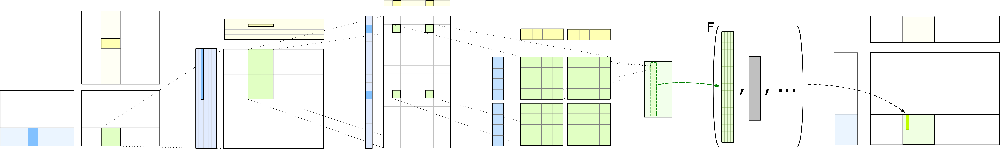
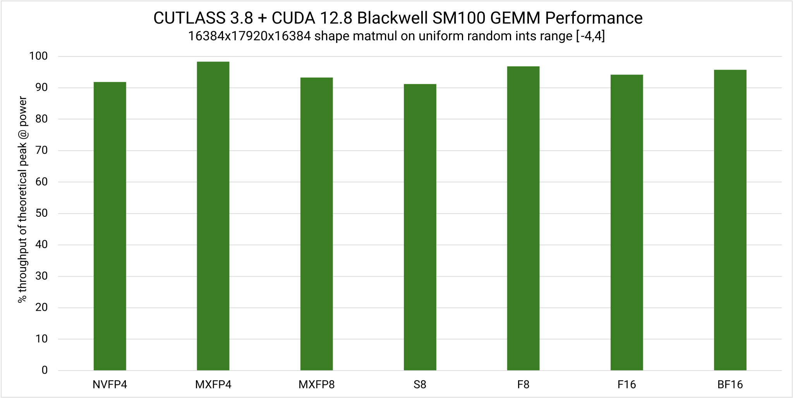
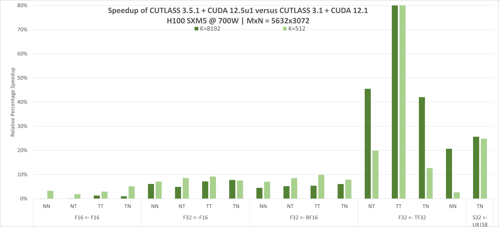
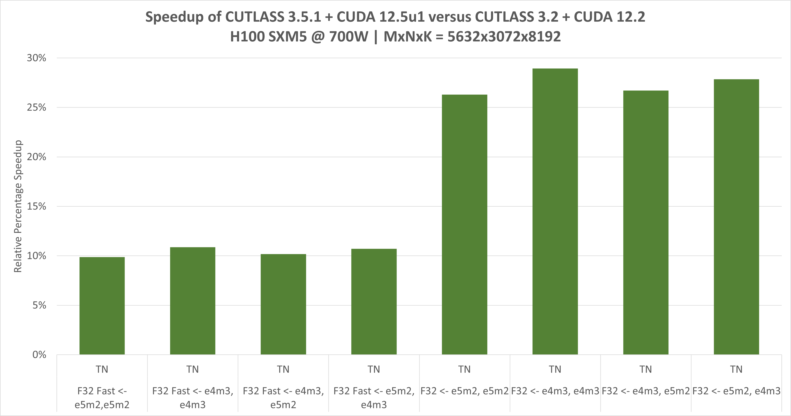

[ [English](README.md) | 简体中文 ]

# 概述 (Overview)

# CUTLASS 4.8.1

_CUTLASS 4.8.1 - 2026 年 10 月_

CUTLASS 是用于在 CUDA 内各层次与尺度实现高性能矩阵乘法（GEMM）及相关计算的抽象集合。它融合了分层分解与数据搬运策略，将这些“可变组件”解耦为可复用、模块化的软件组件与抽象。

概念并行化体系中不同层次的原语均可通过自定义分块尺寸（tiling sizes）、数据类型及其他算法策略进行特化与调优。这种灵活性极大简化了它们作为构建基块在自定义算子和应用程序中的使用。

自 2017 年以来，CUTLASS 一直在为高性能线性代数提供 CUDA C++ 模板抽象，这些抽象为广泛的计算提供了深厚支持，包括混合精度计算、专用数据搬运（异步复制 / async copy）以及适用于 FP64、FP32、TF32、FP16、BF16、[基于 Tensor Core 指令的 FP32 仿真](https://github.com/NVIDIA/cutlass/tree/main/examples/27_ampere_3xtf32_fast_accurate_tensorop_gemm)、8 位浮点类型（e5m2 和 e4m3）、块缩放数据类型（NVIDIA NVFP4 以及 OCP 标准 MXFP4、MXFP6、MXFP8）、窄整型类型（4 位与 8 位有符号/无符号整数）以及二进制 1 位数据类型的乘累加抽象（在架构原生支持此类数据类型的情况下），覆盖 NVIDIA Volta、Turing、Ampere、Ada、Hopper 及 Blackwell 架构。

在如此丰富的基于 C++ 的算子编程抽象生态之上，CUTLASS 4 新增了 CUTLASS DSL。这是一组基于核心 CUTLASS 和 CuTe 概念、用于编写高性能 CUDA 算子的原生 Python 接口，且绝无性能妥协。它带来了更平缓的学习曲线、提升数个数量级的编译速度、无需编写胶水代码即可与深度学习框架原生集成，以及无需深厚 C++ 功底即可进行的直观元编程。

总体而言，我们将 CUTLASS DSL 规划为一个领域特定语言（DSL）家族。在 4.0 版本中，我们发布了该家族的第一个成员：CuTe DSL。这是一种完全契合 CuTe C++ 抽象的低级编程模型——完整公开了布局（layout）、张量（tensor）、硬件原子操作（hardware atoms）等核心概念，并赋予对硬件线程与数据层次结构的完全控制权。

CuTe DSL 能够针对 NVIDIA Ampere、Hopper 与 Blackwell 架构中实现的可编程、高吞吐 _Tensor Core_，展现出最优的矩阵乘法及其他线性代数运算性能。

我们相信它将成为学生、研究人员以及性能工程师不可或缺的工具——大幅降低 GPU 编程门槛，加速算子设计原型迭代，并快速将优化方案投入生产环境。

CuTe DSL 当前处于公开测试阶段（Public Beta），预计将于 2026 年夏末正式转正。

快速上手指引请参阅：
  - [CUTLASS C++ 快速入门指南](https://docs.nvidia.com/cutlass/latest/media/docs/cpp/quickstart.html)。
  - [CuTe DSL 快速入门指南](https://docs.nvidia.com/cutlass/latest/media/docs/pythonDSL/quick_start.html)。

# CUTLASS 4.8 新特性

## CuTe DSL
* 新增功能
  - 对 Rubin 架构提供用于加速稠密 GEMM 的初步支持。包含以下特性：
    - CuTe DSL 与 CuTe 扩展
      - 支持更高吞吐量的 FP8（MMA_K=64）与 FP4（MMA_K=128）Tensor Core MMA 指令
      - B 收集器复用（B collector reuse）
      - 将 TMEM 容量从 512 列扩展至 576 列
      - 更大的共享内存分配上限（328KB）
      - 增强的混合精度吞吐量（FP8/FP4）
      - Softmax 加速相关特性
    - 计算原语（Primitives）
      - 支持更高吞吐量的 FP8（MMA_K=64）与 FP4（MMA_K=128）Tensor Core MMA 指令
      - B 收集器复用
      - 将 TMEM 容量从 512 列扩展至 576 列
      - 更大的共享内存分配上限（328KB）
      - 增强的混合精度吞吐量（FP8/FP4）
      - Softmax 加速相关特性
      - 对 FP4 的 2:4 稀疏性支持

  - CuTe DSL 扩展包含多项新特性：
    - CTA-V 映射现已针对 `cute_ext` TMA 加载、存储、多播（multicast）和规约存储（reduce-store）操作自动推断。显式 CTA-V 映射仍作为覆盖项受支持。
    - 新增异步原子 TMA 规约存储与稀疏 MMA 操作。
    - 新增可复用的 `cute_ext` GEMM 主循环与 TMA 后处理（epilogue）辅助函数。
    - 新增可选的 TMEM 累加器缓冲区规划，包括针对容量受限算子的重叠乒乓存储。
    - 通过 SMEM 暂存更新、工作区复用以及减少序言（prologue）与同步开销，提升了设备端 TMA 描述符更新和分组 GEMM（Grouped GEMM）性能。
  - 本次发布包含普通 Cute DSL 算子的 CuTe DSL 扩展（`cute_ext`）编译器流水线可选预览版。该流水线允许用户直接在 `@cute.jit` 和 `@cute.kernel` 代码中混用 `cute_ext` API，且混合两个 API 界面的算子必须使用该流水线。可以通过以下命令测试此特性：
  `CUTE_DSL_USE_EXTENSION_COMPILER=1 python your_program.py`
  该流水线预计将保持程序行为和性能不变，但生成的 PTX/SASS 可能会有所不同。请注意，该流水线将在未来（不早于 4.10）成为默认选项。
  - 添加了示例，用于更好地控制 4.7.0 中引入的原语编译器警告/错误。详见 `CuTeDSL/experimental/compiler_diagnostic/` 目录。
  - IKET 性能分析工具（IKET Profiler Tool）
    - 现已支持对 Rubin 算子（sm107）进行性能分析。
    - 现支持仅导出特定 cluster 的计时数据以降低性能分析开销。此前会对所有 cluster 进行分析。
    - 任务调度可以在构造 TaskManager 对象时（`iket_enable_profiling=True`）使用 IKET 范围对调度进行插桩。任务执行将生成 IKET 范围，调度中的各个流水线阶段亦可生成独立范围（`iket_profiling_stages`）。
  - 本次发布新增了大量示例：
    - Rubin (CuTe):
      - 适用于传统数据类型且按需复用 B 收集器的稠密 GEMM
      - 带 B 收集器复用的分组 GEMM
      - 支持 FP4/FP6/FP8 混合精度以及 UE5M3 / block-32 缩放因子的稠密块缩放 GEMM
      - 按需复用 B 收集器的分组块缩放 GEMM
      - 块级 GEMM（Blockwise GEMM）
    - Rubin (CuTe extension):
      - 支持带 UE5M3 缩放因子的更高吞吐量 FP8（MMA_K=64）与 FP4（MMA_K=128）块缩放 GEMM
      - 带 B 收集器复用的分组 GEMM
    - Blackwell (CuTe extension):
      - 稠密 GEMM
        - 背靠背 GEMM（Back-to-back GEMM）
        - 块缩放 GEMM
        - 带 alpha/beta 缩放的持久化 GEMM（Persistent GEMM）
        - CLC 调度器 / 动态持久化 GEMM
        - GLU GEMM
        - 混合输入 GEMM
        - 平面复数 GEMM（Planar complex GEMM）
        - 输入变换 GEMM
        - GeForce 乒乓稠密 GEMM
        - Blackwell Ultra 块缩放 GEMM
      - 稠密卷积
        - 隐式 GEMM 前向传播卷积（Implicit-Gemm Fprop Conv）
        - 块缩放隐式 GEMM 前向传播卷积
        - GeForce 隐式 GEMM 前向传播卷积
        - GeForce 块缩放隐式 GEMM 前向传播卷积
      - 注意力机制（Attention）
        - GQA 解码（GQA Decode）
      - 分组 GEMM
        - 无缩放与块缩放分组 GEMM
      - Top-K
    - Ampere (CuTe extension):
      - SIMT GEMM
  - CuTe DSL 现已支持 x86_64 Windows 系统
  - CuTe DSL AoT 现已支持新的主机目标：QNX8.0
  - Notebook 示例在 examples/python/CuTeDSL/cute/notebooks 下进行了重构，计算原语的新 notebook 将添加在 examples/python/CuTeDSL/notebooks 下
  - Numpy 现已不再作为默认依赖项

* 错误修复与改进：
  - `nvidia-cuda-nvdisasm` 现作为 `nvidia-cutlass-dsl` 通过可选的 `[sass]` extra 提供的可选依赖项。SASS 转储（`CUTE_DSL_KEEP=sass` / KeepSASS）现通过捆绑的 wheel 解析 `nvdisasm`（推荐方式，因为其版本与 DSL 工具链一致）或通过本地 CUDA Toolkit（`CUDA_HOME`/`CUDA_PATH`）解析。本地提供的 `nvdisasm` 必须来自至少与生成 CUBIN 的工具链一样新的 CUDA Toolkit。从不转储 SASS 的安装不受影响。
  - 将 IKET 分析器的 protobuf 版本要求从 6.30 降低至 4.21。这使得满足 protobuf 要求更为容易，为将 IKET 转为可选 extra 做好准备。
  - 针对 `cutlass.jax.cutlass_call` 改进了 JAX PyTree 输入/输出别名机制。
  - 修复了 4.6.0 中的回归问题：对于具有动态步长（stride）的张量，`cute.autovec_copy` 会发射逐元素指令而非向量化指令（[!3463](https://github.com/NVIDIA/cutlass/issues/3463)）。
  - 修复了元组中 GPU 张量的 TVM-FFI 环境流检测问题（[!3444](https://github.com/NVIDIA/cutlass/issues/3444)）。
  - 修复了 GPU `link-libraries` 编译选项顺序，使其跨进程保持稳定（[!3564](https://github.com/NVIDIA/cutlass/issues/3564)）。
  - 修复了在无参数暂存 `bool()` 上的预处理器 `IndexError`（[!3506](https://github.com/NVIDIA/cutlass/issues/3506)）。
  - 针对 `@cute.kernel` 上的 `cute.compile` 拒绝执行并给出用户错误提示，而非内部编译器错误（ICE）（[!3429](https://github.com/NVIDIA/cutlass/issues/3429)）。
  - 修复了在 REPL 中使用时 CuTe DSL 导致 Python 解释器崩溃的问题（[!3413](https://github.com/NVIDIA/cutlass/issues/3413)）。
  - 修复了 cuDNN Frontend FROST SDPA 反向编译失败的问题（[!3594](https://github.com/NVIDIA/cutlass/issues/3594)）。
  - 修复了 cuDNN Frontend SM100 不规则（ragged）SDPA 算子在 TVM-FFI 启动时的 SIGABRT 问题（[!3595](https://github.com/NVIDIA/cutlass/issues/3595)）。
  - 修复了 `cute.extern` 中零参数函数会生成无效类型签名的问题。此类函数第二次编译时会失败。
  - 针对指定内存属性的 `CopyUniversalOp`，现会发出明确的错误/警告提示（[!3711](https://github.com/NVIDIA/cutlass/issues/3711)）。
  - CUTLASS Primitives 的 `tensormap_replace` 现在描述符缩小至小于原始范围（如分组 GEMM）时保持设备端 TMA 描述符更新的安全，并修复了 Blackwell/Rubin 上可能发生的非法内存访问。可以通过指定 `keep_oob_fetch_window=True` 来停用此行为。有关已知的 `cuTensorMapEncodeTiled` 错误详情，请参见 https://docs.nvidia.com/datacenter/tesla/tesla-release-notes-595-91-07/index.html#known-issues。
  - 修复了意外修改 `sys.path` 从而可能破坏未安装 Torch 的环境（如 JAX）中导入的问题。

* 已知问题
  - 由于 CTK 中的一个错误，使用某些打包（packed）指令会导致生成无效代码。鉴于指令的性质及其显式使用方式，我们选择不以静默方式重写这些指令，而是在上游编译器修复发布前发出提示。
  - 避免通过内联 PTX `sub.rn.e4m3x4.e4m3x4` 或 `sub.rn.e5m2x4.e5m2x4` 进行打包的高吞吐量 FP8（MMA_K=128）减法操作，因为不正确的代码生成可能会产生错误结果。
  - 某些 CUTLASS Primitives 打包混合输入算子在 Rubin（sm107a/sm107f）上编译不正确，导致代码生成错误。具体模式包括：
    - 结果类型为 bf16x2 或 fp16x2、输入类型为 f32x2，且结果随后转换为 fp32 的打包 mul、sub 与 add 算子。受影响的 API：`add_packed_f16x2_f32x2_f32x2`、`add_packed_bf16x2_f32x2_f32x2`、`mul_packed_f16x2_f32x2_f32x2`、`mul_packed_bf16x2_f32x2_f32x2`、`sub_packed_f16x2_f32x2_f32x2`、`sub_packed_bf16x2_f32x2_f32x2`
      - 例如：
        ```python
        x = prims.mul_packed_bf16x2_f32x2_f32x2(a, b)
        out[0], out[1] = f32(x[0]), f32(x[1])  # out[0], out[1] 计算错误
        ```
    - 结果类型为 bf16x2 或 fp16x2、输入类型为混合 bf16x2 和 fp16x2，且第一个操作数为编译期常量的打包 mul 算子。受影响的 API：`mul_packed_bf16x2_bf16x2_f16x2`、`mul_packed_f16x2_f16x2_bf16x2`
      - 例如：
        ```python
        x = prims.mul_packed_bf16x2_bf16x2_f16x2(2.0, b) # x 计算错误
        x = prims.mul_packed_f16x2_f16x2_bf16x2(2.0, b)  # x 计算错误
        ```

本版本已针对以下软件包进行了测试：
  - FlashAttention: [main (1fc0221)](https://github.com/Dao-AILab/flash-attention/commit/1fc0221183e799363001394a12dd9e78e15f5dda)
  - Quack: [main (35266c32)](https://github.com/Dao-AILab/quack/commit/35266c3298f0e9bf6d5f46c30aace2eaeae517e3)
  - FlashInfer: [main (399b6c1)](https://github.com/flashinfer-ai/flashinfer/commit/399b6c1d31a13f38dd827018f89c6a04c8487acb)
  - cuDNN-Frontend: [deveop (986ef4d)](https://github.com/NVIDIA/cudnn-frontend/commit/986ef4d9078089ae9f0656dd65f15011309e4347)
  - Pytorch: [main (ca883d5)](https://github.com/pytorch/pytorch/commit/ca883d596dd5c0ce182976ed979d69d167ad706c)
  - TensorRT-LLM: [main (cc63e66)](https://github.com/NVIDIA/TensorRT-LLM/commit/cc63e66daf52644f1441e117bb7ba67d20566016)

## CUTLASS Operator API
* Operator API 中的稠密与块缩放 GEMM 提供了对 Rubin 的初步支持。这些作为预览版提供，可能需要进一步的性能调优。
  - 更新后的 GEMM 包括：
    - 稠密 GEMM: FP8xFP8
    - 块缩放 GEMM: {MXFP8}x{MXFP4, MXFP8} 以及 {MXFP4, NVFP4}x{MXFP4, NVFP4}（包括针对 NVFP4 支持新的 UE5M3 缩放因子数据类型）。
  - 这些算子利用了 Rubin 中的以下新特性：
    - 更高的 SMEM（328KB）与 TMEM 容量（288KB）
    - B 缓冲区复用
    - 增强的混合精度吞吐量

* 在 nvMatmulHeuristics 可用时，算子现可根据其估算性能进行排序。请参阅此处教程。注意：目前仅支持 Blackwell 算子，因为 nvMatmulHeuristics 尚不支持 Rubin。
* 独立算子实现现已通过 `cutlass.kernels` 公开。除了可通过 `cutlass.operators` 中的 Operator 接口发现和使用之外，还可以直接使用这些算子。
* 自定义 Epilogue 融合现已支持逐行或逐列规约。
* `IndexPtrGroupedGemmArguments` 现用于表示具有连续偏移量/索引指针的分组 GEMM。现有的 `GroupedGemmArguments` 已被弃用，并将在未来版本中移除。

## C++
* 通过 CuTe C++ 构建基块添加了初步的 Rubin 支持（SM107）：
 - [Rubin Tensor Core MMA 指令](https://github.com/NVIDIA/cutlass/blob/main/include/cute/arch/mma_sm107_umma.hpp) 以及相应的 [CuTe MMA 特性](https://github.com/NVIDIA/cutlass/blob/main/include/cute/atom/mma_traits_sm107.hpp)。
* 展示 Rubin SM107 Tensor Core 指令使用的 CuTe 示例：
 - [稠密 FP8 GEMM](https://github.com/NVIDIA/cutlass/blob/main/examples/cute/rubin/rubin_fp8.cu)。
 - [块缩放 FP8 GEMM](https://github.com/NVIDIA/cutlass/blob/main/examples/cute/rubin/rubin_fp8_blockscaled.cu)。
 - [混合精度块缩放 FP8/FP4 GEMM](https://github.com/NVIDIA/cutlass/blob/main/examples/cute/rubin/rubin_fp8_blockscaled.cu)。
 - [块缩放 FP4 GEMM](https://github.com/NVIDIA/cutlass/blob/main/examples/cute/rubin/rubin_fp4_blockscaled.cu)。
* 调整了 Rubin SM107 的共享内存与张量内存容量处理：
 - 将 [SM107 共享内存容量](https://github.com/NVIDIA/cutlass/blob/main/include/cutlass/arch/arch.h) 设置为 327 KiB，并为超大共享内存配置添加了启动支持。
 - 将 [SM107 TMEM 容量](https://github.com/NVIDIA/cutlass/blob/main/include/cute/arch/tmem_capacity_sm100.hpp) 设置为每个 SM 576 列，针对 Rubin 的独占分配路径更新了 [CuTe 1SM 和 2SM TMEM 分配器](https://github.com/NVIDIA/cutlass/blob/main/include/cute/arch/tmem_allocator_sm100.hpp)。
* 为新的 SM107 目标 [`sm_107a` 与 `sm_107f`](https://github.com/NVIDIA/cutlass/blob/main/CMakeLists.txt) 启用了现有的 SM100 兼容 [GEMM](https://github.com/NVIDIA/cutlass/tree/main/include/cutlass/gemm/collective/builders) 与 [卷积](https://github.com/NVIDIA/cutlass/blob/main/include/cutlass/conv/collective/builders/sm100_umma_builder.inl)：
 - 针对 Rubin SM107 的单元测试集：[SIMT GEMM](https://github.com/NVIDIA/cutlass/blob/main/test/unit/gemm/device/sm107_gemm_f32_f32_f32_simt_align1_multi_cluster_shape.cu)、[稠密 FP8 GEMM](https://github.com/NVIDIA/cutlass/blob/main/test/unit/gemm/device/sm107_gemm_f8_f8_f8_tensor_op_f32_alignx.cu)、[块缩放 FP8 GEMM](https://github.com/NVIDIA/cutlass/blob/main/test/unit/gemm/device/sm107_gemm_f8_f8_f8_tensor_op_f32_blockwise.cu)、[块缩放 FP4 GEMM](https://github.com/NVIDIA/cutlass/blob/main/test/unit/gemm/device/sm107_gemm_f4_f4_f32_tensor_op_f32_2sm_256x192.cu) 以及 [混合精度、复数与 9xBF16 GEMM](https://github.com/NVIDIA/cutlass/blob/main/test/unit/gemm/device/sm107_gemm_umma.cu)。

注意：执行 Rubin 算子（SM107）需要 R615 驱动程序，该驱动程序将随 CUDA Toolkit 13.4 GA 一同发布。来自 CUDA Toolkit 13.4 Developer Preview 的 R610 驱动无法满足要求。

**有关历次版本更新详情，请参阅 [CHANGELOG](https://docs.nvidia.com/cutlass/latest/CHANGELOG.html)。**

# 性能表现 (Performance)

CUTLASS 原语极为高效。在用于构建设备级 GEMM 算子时，它们能够实现接近理论峰值吞吐量的利用率。下图展示了在 NVIDIA Blackwell SM100 架构 GPU 上运行时，CUTLASS 3.8 在各类输入和输出数据类型下相对于理论峰值利用率的百分比表现。



下两幅图展示了自 CUTLASS 3.1 以来，在 [NVIDIA H100](https://www.nvidia.com/en-us/data-center/h100/)（NVIDIA Hopper 架构）上 CUTLASS 性能的持续演进。CUTLASS 3.5.1 使用 [CUDA 12.5u1 Toolkit](https://developer.nvidia.com/cuda-downloads) 编译。Tensor Core 操作通过 CUDA 的 [mma](https://docs.nvidia.com/cuda/parallel-thread-execution/index.html#warp-level-matrix-instructions-mma) 与 [wgmma](https://docs.nvidia.com/cuda/parallel-thread-execution/index.html#asynchronous-warpgroup-level-matrix-instructions) 指令实现。




# CuTe

CUTLASS 3.0 引入了全新的核心库 CuTe，用于描述和操作线程与数据张量。CuTe 是一组 C++ CUDA 模板抽象，用于定义和操作线程与数据的多维分层布局（Layout）。CuTe 提供了 `Layout` 与 `Tensor` 对象，将数据的类型、形状（shape）、内存空间与布局紧凑打包，同时为用户处理复杂的索引计算。这使程序员能够专注于算法的逻辑描述，而由 CuTe 处理繁杂的账务映射。借助这些工具，我们能够迅速设计、实现并调整所有稠密线性代数操作。

CuTe 的核心抽象是多维分层布局，它可以与数据数组组合以表示张量。布局的表达能力足以涵盖实现高效稠密线性代数所需的几乎所有机制。布局还可以通过函数式组合进行组合与操作，在此之上我们构建了诸如分块（tiling）和分区（partitioning）等大量常见操作。

CUTLASS 3.0 及更高版本在其模板中贯穿了 GEMM 各层级的 CuTe 抽象。这极大地简化了设计，提升了代码的可组合性与可读性。有关 CuTe 的更多专属文档，请参阅其[专属文档目录](https://docs.nvidia.com/cutlass/latest/media/docs/cpp/cute/00_quickstart.html)。

# 兼容性 (Compatibility)

最低环境要求：

- GPU 架构：Volta（计算能力 7.0）
- 编译器：必须至少支持 C++17
- CUDA Toolkit 版本：11.4

CUTLASS 需要支持 C++17 的主机编译器，在使用 [**CUDA 12.8 Toolkit**](https://developer.nvidia.com/cuda-downloads) 构建时能达到最佳性能。它亦兼容 CUDA 11.4、CUDA 11.5、CUDA 11.6、CUDA 11.7、CUDA 11.8 及所有其他 CUDA 12.x 版本。

## 操作系统

我们测试了以下环境：

|**操作系统** | **编译器** |
|-----------------|----------|
| Ubuntu 18.04 | GCC 7.5.0  |
| Ubuntu 20.04 | GCC 10.3.0 |
| Ubuntu 22.04 | GCC 11.2.0 |

注意：GCC 8.5.0 在折叠表达式（fold expressions）和重载运算符方面存在已知回归问题。建议使用 GCC 7.5.0 或（首选）GCC >= 9。

注意：在所有 CUDA 工具包下，CUTLASS 3.x 在 Windows 平台上的构建目前已知不可用。CUTLASS 团队正在积极修复该问题。

## 硬件支持

CUTLASS 能够在以下 NVIDIA GPU 上成功运行，并预期在基于 Volta、Turing、Ampere、Ada 和 Hopper 架构的 NVIDIA GPU 上保持高效表现：

|**GPU**|**CUDA 计算能力**|**CUTLASS-3 所需最低 CUDA Toolkit**|
|---|---|---|
|NVIDIA V100 Tensor Core GPU            |7.0|11.4|
|NVIDIA TitanV                          |7.0|11.4|
|NVIDIA GeForce RTX 20x0 系列           |7.5|11.4|
|NVIDIA T4                              |7.5|11.4|
|NVIDIA A100 Tensor Core GPU            |8.0|11.4|
|NVIDIA A10                             |8.6|11.4|
|NVIDIA GeForce RTX 30x0 系列           |8.6|11.4|
|NVIDIA GeForce RTX 40x0 系列           |8.9|11.8|
|NVIDIA L40                             |8.9|11.8|
|NVIDIA H100 Tensor Core GPU            |9.0|11.8|
|NVIDIA H200 Tensor Core GPU            |9.0|11.8|
|NVIDIA B200 Tensor Core GPU            |10.0|12.8|
|NVIDIA B300 Tensor Core GPU            |10.3|13.0|
|NVIDIA DRIVE Thor                      |11.0|13.0|
|NVIDIA GeForce RTX 50x0 系列           |12.0|12.8|
|NVIDIA DGX Spark                       |12.1|13.0|

## 目标架构

通常情况下，为一个目标架构生成的 PTX 代码可以在未来的架构上运行（即具备向前兼容性）。然而，CUDA 12.0 引入了“架构加速特性”（architecture-accelerated features）的概念，其 PTX 不具备向前兼容性保证。若干 Hopper 和 Blackwell PTX 指令属于此类架构加速特性，因此需要 `sm_90a` 或 `sm100a` 目标架构（注意附加的 "a"）。有关此特性及其他架构加速指令的更多详情，请参阅 [CUDA 官方文档](https://docs.nvidia.com/cuda/cuda-c-programming-guide/index.html#feature-availability)。

目标架构信息通过 cmake 标志 `CUTLASS_NVCC_ARCHS` 传递给 CUTLASS。为了在 Hopper GH100 上最大化性能，用户必须以 `90a` 作为目标架构构建 CUTLASS。如果用户在 CUDA Toolkit 12 或 11.8 下意外使用 SM90 目标（注意缺少 "a"）构建了使用 SM90a 特性（例如 Hopper Tensor Core 指令）的算子，该算子预计将因运行时错误而失败。

```bash
cmake .. -DCUTLASS_NVCC_ARCHS="90a"
```
或

```bash
cmake .. -DCUTLASS_NVCC_ARCHS="100a"
```

注意：数据中心产品中使用的 NVIDIA Blackwell SM100 架构与 NVIDIA Blackwell GeForce RTX 50 系列 GPU（SM120）的基础计算能力不同。因此，为 Blackwell SM100 架构编译且带有架构条件特性（使用 `sm100a`）的算子与 RTX 50 系列 GPU 不兼容。

有关哪些算子需要特定目标架构的详细信息，请参阅[功能文档](https://docs.nvidia.com/cutlass/latest/media/docs/cpp/functionality.html)。

# 文档索引 (Documentation)

CUTLASS 的详细说明可在以下文档及附带的 [Doxygen 文档](https://nvidia.github.io/cutlass)中查阅：

- [快速入门指南 (Quick Start Guide)](https://docs.nvidia.com/cutlass/latest/media/docs/cpp/quickstart.html) —— 构建与运行 CUTLASS 的基础知识
- [功能说明 (Functionality)](https://docs.nvidia.com/cutlass/latest/media/docs/cpp/functionality.html) —— 概述 CUTLASS 中提供的功能
- [CUDA 高效 GEMM (Efficient GEMM in CUDA)](https://docs.nvidia.com/cutlass/latest/media/docs/cpp/efficient_gemm.html) —— 阐述如何在 CUDA 中高效实现 GEMM 算子
- [CUTLASS 3.x 设计理念](https://docs.nvidia.com/cutlass/latest/media/docs/cpp/cutlass_3x_design.html) —— 介绍 CUTLASS 3.x 的设计架构、优势以及 CuTe 如何赋能编写高可组合性的组件
- [GEMM API 3.x](https://docs.nvidia.com/cutlass/latest/media/docs/cpp/gemm_api_3x.html) —— 介绍 CUTLASS 3.x 的 GEMM 模型与 C++ 模板概念
- [GEMM API 2.x](https://docs.nvidia.com/cutlass/latest/media/docs/cpp/gemm_api.html) —— 介绍 CUTLASS 2.x 的 GEMM 模型与 C++ 模板概念
- [隐式 GEMM 卷积 (Implicit GEMM Convolution)](https://docs.nvidia.com/cutlass/latest/media/docs/cpp/implicit_gemm_convolution.html) —— 介绍 CUTLASS 中的二维与三维卷积实现
- [代码组织架构 (Code Organization)](https://docs.nvidia.com/cutlass/latest/media/docs/cpp/code_organization.html) —— 阐述 CUTLASS 项目的目录组织与内容
- [术语表 (Terminology)](https://docs.nvidia.com/cutlass/latest/media/docs/cpp/terminology.html) —— 解释代码中使用的各项专业术语
- [编程规范 (Programming Guidelines)](https://docs.nvidia.com/cutlass/latest/media/docs/cpp/programming_guidelines.html) —— 编写高效现代 CUDA C++ 的指导原则
- [基础类型 (Fundamental types)](https://docs.nvidia.com/cutlass/latest/media/docs/cpp/fundamental_types.html) —— 描述 CUTLASS 中用于表示数值量和数组的基本 C++ 类
- [布局 (Layouts)](https://docs.nvidia.com/cutlass/latest/media/docs/cpp/layout.html) —— 描述内存中矩阵与张量的布局
- [分块迭代器 (Tile Iterators)](https://docs.nvidia.com/cutlass/latest/media/docs/cpp/tile_iterator_concept.html) —— 描述在内存中迭代遍历矩阵图块的 C++ 概念
- [CUTLASS Profiler](https://docs.nvidia.com/cutlass/latest/media/docs/cpp/profiler.html) —— 命令行驱动的性能分析应用程序
- [CUTLASS 实用工具 (Utilities)](https://docs.nvidia.com/cutlass/latest/media/docs/cpp/utilities.html) —— 用于加速开发的辅助类模板
- [依赖算子启动 (Dependent kernel launch)](https://docs.nvidia.com/cutlass/latest/media/docs/cpp/dependent_kernel_launch.html) —— 描述 Hopper 中的新特性，允许在同一流中重叠执行具有依赖关系的算子，以及在 CUTLASS 中的具体用法

# 资源与演讲 (Resources)
我们亦在 [GPU Technology Conference 2018](http://on-demand.gputechconf.com/gtc/2018/presentation/s8854-cutlass-software-primitives-for-dense-linear-algebra-at-all-levels-and-scales-within-cuda.pdf) 的演讲中详细阐述了高效 GEMM 的结构体系：

- [CUTLASS: Software Primitives for Dense Linear Algebra at All Levels and Scales within CUDA](https://www.nvidia.com/en-us/on-demand/session/gtcsiliconvalley2018-s8854/)
- [Developing CUDA Kernels to Push Tensor Cores to the Absolute Limit on NVIDIA A100](https://www.nvidia.com/en-us/on-demand/session/gtcsj20-s21745/)
- [Accelerating Convolution with Tensor Cores in CUTLASS](https://www.nvidia.com/en-us/on-demand/session/gtcspring21-s31883/)
- [Accelerating Backward Data Gradient by Increasing Tensor Core Utilization in CUTLASS](https://www.nvidia.com/en-us/on-demand/session/gtcspring22-s41996/)
- [CUTLASS: Python API, Enhancements, and NVIDIA Hopper](https://www.nvidia.com/en-us/on-demand/session/gtcfall22-a41131/)

# 构建 CUTLASS (Building CUTLASS)

CUTLASS 是纯头文件（header-only）模板库，其他项目无需额外编译构建即可直接使用。客户端应用程序只需在包含路径中指定 CUTLASS 的 `include/` 目录即可。

CUTLASS 单元测试、示例与实用工具可通过 CMake 构建。CMake 的最低版本要求参见[快速入门指南](https://docs.nvidia.com/cutlass/latest/media/docs/cpp/quickstart.html)。请确保环境变量 `CUDACXX` 指向系统中安装的 CUDA Toolkit 的 NVCC 路径：

```bash
$ export CUDACXX=${CUDA_INSTALL_PATH}/bin/nvcc
```

在 CUTLASS 项目内创建构建目录，然后运行 CMake。默认情况下，CUTLASS 会针对 CUDA 架构版本 5.0、6.0、6.1、7.0、7.5、8.0、8.6、8.9 和 9.0 构建算子。为缩短编译时间，可通过修改 CMake 配置选项 `CUTLASS_NVCC_ARCHS` 来指定需要构建的目标架构：

```bash
$ mkdir build && cd build

$ cmake .. -DCUTLASS_NVCC_ARCHS=80               # 针对 NVIDIA Ampere 架构进行编译
```

在 `build/` 目录下，通过 make 构建目标 `test_unit` 即可编译并运行 CUTLASS 单元测试。

单元测试被组织为对应 CUTLASS 顶级命名空间的若干二进制可执行文件，可通过 make 的 `-j` 命令行参数进行并行执行：

```bash
$ make test_unit -j
...
...
...
[----------] Global test environment tear-down
[==========] 946 tests from 57 test cases ran. (10812 ms total)
[  PASSED  ] 946 tests.
```

在受支持的平台上所有测试均应通过，但具体测试数量可能会随版本演进而有所变化。

# 项目结构 (Project Structure)

CUTLASS 组织为头文件模板库以及 Utilities、Tools、Examples 和单元测试。完整的文件、类和模板概念清单可参阅 [Doxygen 文档](https://nvidia.github.io/cutlass)。

源码组织的详细阐述可参阅 [CUTLASS 文档](https://docs.nvidia.com/cutlass/latest/media/docs/cpp/code_organization.html)，以下总结了几个核心组件：

## CUTLASS 模板库

```
include/                     # 客户端应用程序应在其构建包含路径中指向此目录

  cutlass/                   # 线性代数子程序与求解器的 CUDA 模板 —— 仅头文件

    arch/                    # 直接公开硬件架构特性（包含指令级 GEMM）

    conv/                    # 专用于卷积的代码

    epilogue/                # 专用于 GEMM/卷积后处理（epilogue）的代码

    gemm/                    # 专用于通用矩阵乘法计算的代码

    layout/                  # 内存中矩阵、张量及其他数学对象的布局定义

    platform/                # 支持 CUDA 的标准库组件

    reduction/               # 不适合 "gemm" 模型的受限于带宽的规约算子

    thread/                  # 可在单个 CUDA 线程内执行的 SIMT 代码

    transform/               # 专用于布局、类型和域变换的代码

    *                        # 核心词汇类型、容器与基本数值运算

  cute/                      # CuTe 布局、布局代数、MMA/Copy 原子操作、平铺 MMA/Copy

    algorithm/               # 核心操作定义，如 copy、gemm 以及针对 cute::tuple 的操作

    arch/                    # 针对 copy 和数学指令的基础 PTX 封装结构体

    atom/                    # 链接到 arch/ 运算符或从中构建的元信息

      mma_atom.hpp           # cute::Mma_Atom 与 cute::TiledMma

      copy_atom.hpp          # cute::Copy_Atom 与 cute::TiledCopy

      *sm*.hpp               # 针对复制与数学运算的架构专用元信息

    *                        # 核心库类型，如 Shape、Stride、Layout、Tensor 及相关操作

```

### CUTLASS SDK 示例

[CUTLASS SDK 示例](https://github.com/NVIDIA/cutlass/tree/main/examples) 应用 CUTLASS 模板来实现基础计算。

### 工具 (Tools)

```
tools/
  library/                   # CUTLASS 实例化库 —— 包含所有受支持 CUTLASS 模板的实例化
    include/
      cutlass/
        library/

  profiler/                  # CUTLASS Profiler —— 用于执行 CUTLASS 库中运算的命令行工具

  util/                      # CUTLASS 实用工具 —— 包含大量辅助类，用于管理设备内存中的张量、
    include/                 # GEMM 参考实现、张量随机初始化以及 I/O 操作。
      cutlass/
        util/
```

### 测试 (Test)

`test/unit/` 目录包含采用 Google Test 实现的单元测试，演示了 Core API 组件的基本用法以及针对 CUTLASS GEMM 计算的完整测试。

构建与运行单元测试的指引详见[快速入门指南](https://docs.nvidia.com/cutlass/latest/media/docs/cpp/quickstart.html)。

# 性能分析与评测 (Performance Profiling)

`tools/profiler/` 目录包含用于启动每个 GEMM 算子的命令行实用工具。可通过如下方式构建：

```bash
$ make cutlass_profiler -j16
```

## 构建所有 GEMM 与卷积算子（编译耗时较长）

默认情况下，对于每种数据类型、数学指令与布局，仅实例化一个分块大小。如需实例化全部，请在空的 `build/` 目录下运行 CMake 时设置以下环境变量。注意，这会导致生成**数以万计**的算子并大幅延长构建时间。这也会导致庞大的二进制体积，并在某些平台上因链接器问题导致库构建失败。因此，强烈建议仅生成算子子集，如下一小节所示。

```bash
$ cmake .. -DCUTLASS_NVCC_ARCHS=90a -DCUTLASS_LIBRARY_KERNELS=all
...
$ make cutlass_profiler -j16
```

## 构建 GEMM 与卷积算子子集（缩短编译时间）

为了精确编译单个算子或一组算子，可以使用包含通配符的逗号分隔算子名称列表来缩减算子集。以下示例展示了针对 NVIDIA Ampere 和 Turing 架构构建单个或一组算子：

### 构建 Tensor Core GEMM 算子子集

若要编译以 FP32 累加、FP16 输入为目标且针对 NVIDIA Ampere 和 Turing 架构的 Tensor Core GEMM 算子子集，请使用以下 cmake 命令行：

```bash
$ cmake .. -DCUTLASS_NVCC_ARCHS='75;80' -DCUTLASS_LIBRARY_KERNELS=cutlass_tensorop_s*gemm_f16_*_nt_align8
...
$ make cutlass_profiler -j16
```

用于分析 Tensor Core GEMM 算子子集的示例命令行如下：

```bash
./tools/profiler/cutlass_profiler --kernels=cutlass_tensorop_s*gemm_f16_*_nt_align8 --m=3456 --n=4096 --k=4096

...
=============================
  Problem ID: 1

        Provider: CUTLASS
   OperationKind: gemm
       Operation: cutlass_tensorop_s1688gemm_f16_256x128_32x2_nt_align8

          Status: Success
    Verification: ON
     Disposition: Passed

reference_device: Passed
          cuBLAS: Passed

       Arguments: --gemm_kind=universal --m=3456 --n=4096 --k=4096 --A=f16:column --B=f16:row --C=f32:column --alpha=1  \
                  --beta=0 --split_k_slices=1 --batch_count=1 --op_class=tensorop --accum=f32 --cta_m=256 --cta_n=128  \
                  --cta_k=32 --stages=2 --warps_m=4 --warps_n=2 --warps_k=1 --inst_m=16 --inst_n=8 --inst_k=8 --min_cc=75  \
                  --max_cc=1024

           Bytes: 118489088  bytes
           FLOPs: 115992428544  flops

         Runtime: 1.55948  ms
          Memory: 70.7616 GiB/s

            Math: 74378.8 GFLOP/s


=============================
...
```

### 构建单个 CUDA Core GEMM 算子

若要编译针对 NVIDIA Ampere 和 Turing 架构的单个 SGEMM 算子，请使用以下 cmake 命令行：

```bash
$ cmake .. -DCUTLASS_NVCC_ARCHS='75;80' -DCUTLASS_LIBRARY_KERNELS=cutlass_simt_sgemm_128x128_8x2_nn_align1
...
$ make cutlass_profiler -j16
```

用于分析单个 SGEMM CUDA 算子的示例命令行如下：

```bash
$ ./tools/profiler/cutlass_profiler --kernels=sgemm --m=3456 --n=4096 --k=4096

=============================
  Problem ID: 1

        Provider: CUTLASS
   OperationKind: gemm
       Operation: cutlass_simt_sgemm_128x128_8x2_nn_align1

          Status: Success
    Verification: ON
     Disposition: Passed

          cuBLAS: Passed

       Arguments: --m=3456 --n=4096 --k=4096 --A=f32:column --B=f32:column --C=f32:column --alpha=1 --beta=0 --split_k_slices=1  \
                  --batch_count=1 --op_class=simt --accum=f32 --cta_m=128 --cta_n=128 --cta_k=8 --stages=2 --warps_m=4  \
                  --warps_n=2 --warps_k=1 --inst_m=1 --inst_n=1 --inst_k=1 --min_cc=50 --max_cc=1024

           Bytes: 180355072  bytes
           FLOPs: 115992428544  flops

         Runtime: 6.73655  ms
          Memory: 24.934 GiB/s

            Math: 17218.4 GFLOP/s

=============================
```

### 构建 Tensor Core 卷积算子子集

若要编译针对 NVIDIA Ampere 和 Turing 架构、实现 FP32 累加且以 FP16 为输入的前向传播（fprop）Tensor Core 卷积算子子集，请使用以下 cmake 命令行：

```bash
$ cmake .. -DCUTLASS_NVCC_ARCHS='75;80' -DCUTLASS_LIBRARY_KERNELS=cutlass_tensorop_s*fprop_optimized_f16
...
$ make cutlass_profiler -j16
```

用于分析 Tensor Core 卷积算子子集的示例命令行如下：

```bash
$ ./tools/profiler/cutlass_profiler --kernels=cutlass_tensorop_s*fprop_optimized_f16 --n=8 --h=224 --w=224 --c=128 --k=128 --r=3 --s=3

...
=============================
  Problem ID: 1

        Provider: CUTLASS
   OperationKind: conv2d
       Operation: cutlass_tensorop_s16816fprop_optimized_f16_128x128_32x5_nhwc

          Status: Success
    Verification: ON
     Disposition: Passed

reference_device: Passed

       Arguments: --conv_kind=fprop --n=8 --h=224 --w=224 --c=128 --k=128 --r=3 --s=3 --p=224 --q=224 --pad_h=1 --pad_w=1  \
                  --stride_h=1 --stride_w=1 --dilation_h=1 --dilation_w=1 --Activation=f16:nhwc --Filter=f16:nhwc --Output=f32:nhwc  \
                  --conv_mode=cross --iterator_algorithm=optimized --alpha=1 --beta=0 --split_k_mode=serial --split_k_slices=1  \
                  --eq_gemm_provider=none --op_class=tensorop --accum=f32 --cta_m=128 --cta_n=128 --cta_k=32 --stages=5  \
                  --warps_m=2 --warps_n=2 --warps_k=1 --inst_m=16 --inst_n=8 --inst_k=16 --min_cc=80 --max_cc=1024

           Bytes: 1130659840  bytes
           FLOPs: 118482796544  flops

         Runtime: 0.711496  ms
          Memory: 1479.99 GiB/s

            Math: 166526 GFLOP/s

=============================
...
```

### 构建单个 CUDA Core 卷积算子

若要编译并运行针对 NVIDIA Ampere 和 Turing 架构、实现 FP32 累加且以 FP32 为输入的前向传播（fprop）单个 CUDA Core 卷积算子，请使用以下 cmake 命令行：

```bash
$ cmake .. -DCUTLASS_NVCC_ARCHS='75;80' -DCUTLASS_LIBRARY_KERNELS=cutlass_simt_sfprop_optimized_128x128_8x2_nhwc
...
$ make cutlass_profiler -j16
```

用于分析单个 CUDA Core 卷积算子的示例命令行：

```bash
$ ./tools/profiler/cutlass_profiler --kernels=cutlass_simt_sfprop_optimized_128x128_8x2_nhwc --n=8 --h=224 --w=224 --c=128 --k=128 --r=3 --s=3


=============================
  Problem ID: 1

        Provider: CUTLASS
   OperationKind: conv2d
       Operation: cutlass_simt_sfprop_optimized_128x128_8x2_nhwc

          Status: Success
    Verification: ON
     Disposition: Passed

reference_device: Passed

       Arguments: --conv_kind=fprop --n=8 --h=224 --w=224 --c=128 --k=128 --r=3 --s=3 --p=224 --q=224 --pad_h=1 --pad_w=1  \
                  --stride_h=1 --stride_w=1 --dilation_h=1 --dilation_w=1 --Activation=f32:nhwc --Filter=f32:nhwc --Output=f32:nhwc  \
                  --conv_mode=cross --iterator_algorithm=optimized --alpha=1 --beta=0 --split_k_mode=serial --split_k_slices=1  \
                  --eq_gemm_provider=none --op_class=simt --accum=f32 --cta_m=128 --cta_n=128 --cta_k=8 --stages=2 --warps_m=4  \
                  --warps_n=2 --warps_k=1 --inst_m=1 --inst_n=1 --inst_k=1 --min_cc=50 --max_cc=1024

           Bytes: 2055798784  bytes
           FLOPs: 118482796544  flops

         Runtime: 7.34266  ms
          Memory: 260.752 GiB/s

            Math: 16136.2 GFLOP/s


=============================

```

## 关于编译 CUTLASS 算子与 CUTLASS Profiler 的更多详情
- 请访问以下链接，了解有关选择性编译 CUTLASS 算子的更多 CMake 示例：
  - [GEMM CMake 示例](https://docs.nvidia.com/cutlass/latest/media/docs/cpp/quickstart.html#gemm-cmake-examples)
  - [隐式 GEMM 卷积 CMake 示例](https://docs.nvidia.com/cutlass/latest/media/docs/cpp/quickstart.html#convolution-cmake-examples)
- [关于 CUTLASS Profiler 的更多细节描述请参阅此处。](https://docs.nvidia.com/cutlass/latest/media/docs/cpp/profiler.html)

# 关于 (About)

CUTLASS 由 NVIDIA Corporation 依据 [3-clause "New" BSD 许可证](LICENSE.txt) 作为开源软件发布。

# 贡献者 (Contributors)

CUTLASS 官方开发者与贡献者名单可在此查阅：[CONTRIBUTORS](CONTRIBUTORS.md)。

# 版权许可 (Copyright)

Copyright (c) 2017 - 2026 NVIDIA CORPORATION & AFFILIATES. All rights reserved.
SPDX-License-Identifier: BSD-3-Clause

```
  Redistribution and use in source and binary forms, with or without
  modification, are permitted provided that the following conditions are met:

  1. Redistributions of source code must retain the above copyright notice, this
  list of conditions and the following disclaimer.

  2. Redistributions in binary form must reproduce the above copyright notice,
  this list of conditions and the following disclaimer in the documentation
  and/or other materials provided with the distribution.

  3. Neither the name of the copyright holder nor the names of its
  contributors may be used to endorse or promote products derived from
  this software without specific prior written permission.

  THIS SOFTWARE IS PROVIDED BY THE COPYRIGHT HOLDERS AND CONTRIBUTORS "AS IS"
  AND ANY EXPRESS OR IMPLIED WARRANTIES, INCLUDING, BUT NOT LIMITED TO, THE
  IMPLIED WARRANTIES OF MERCHANTABILITY AND FITNESS FOR A PARTICULAR PURPOSE ARE
  DISCLAIMED. IN NO EVENT SHALL THE COPYRIGHT HOLDER OR CONTRIBUTORS BE LIABLE
  FOR ANY DIRECT, INDIRECT, INCIDENTAL, SPECIAL, EXEMPLARY, OR CONSEQUENTIAL
  DAMAGES (INCLUDING, BUT NOT LIMITED TO, PROCUREMENT OF SUBSTITUTE GOODS OR
  SERVICES; LOSS OF USE, DATA, OR PROFITS; OR BUSINESS INTERRUPTION) HOWEVER
  CAUSED AND ON ANY THEORY OF LIABILITY, WHETHER IN CONTRACT, STRICT LIABILITY,
  OR TORT (INCLUDING NEGLIGENCE OR OTHERWISE) ARISING IN ANY WAY OUT OF THE USE
  OF THIS SOFTWARE, EVEN IF ADVISED OF THE POSSIBILITY OF SUCH DAMAGE.
```

---

*声明：本中文文档由社区志愿者维护，仅供参考。如有出入，请以[英文原版](README.md)为准。*
