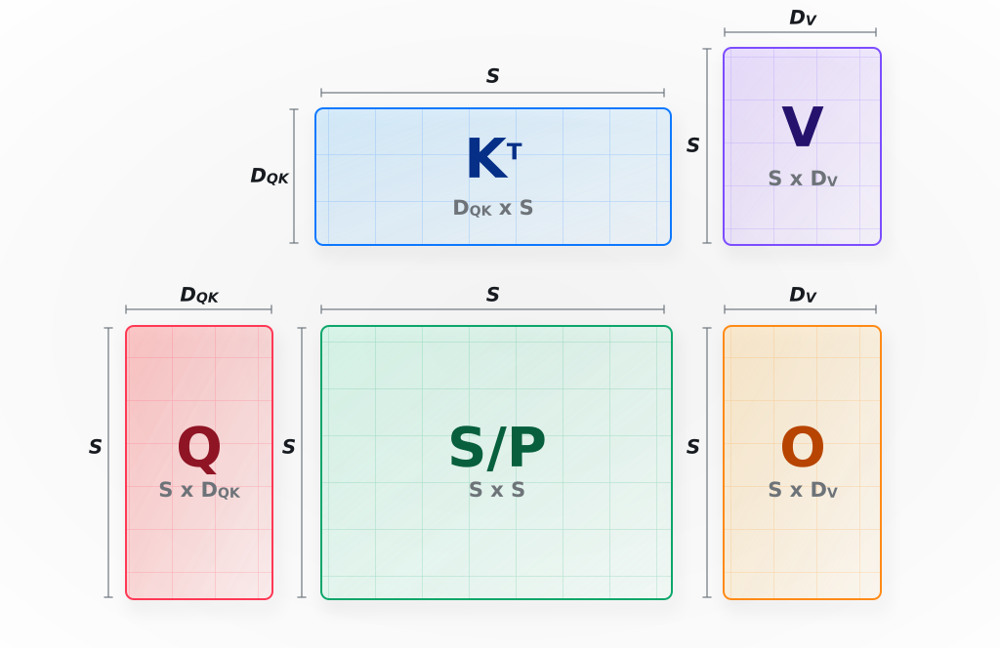
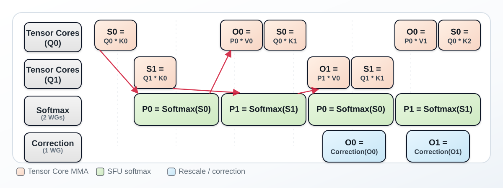
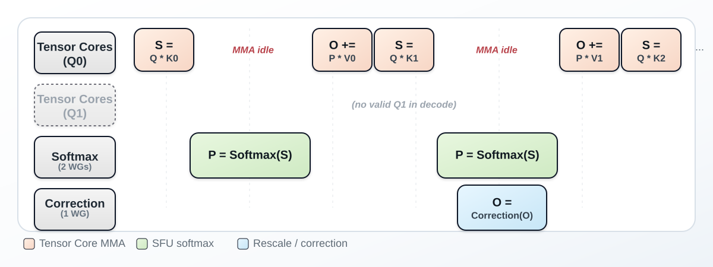
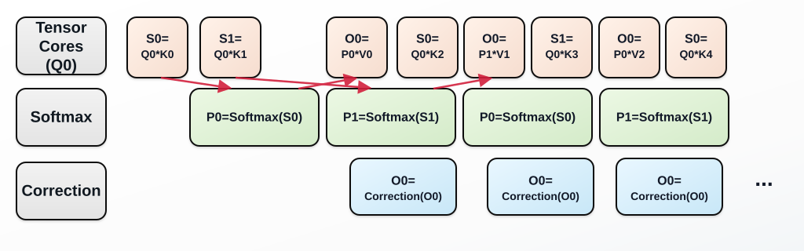
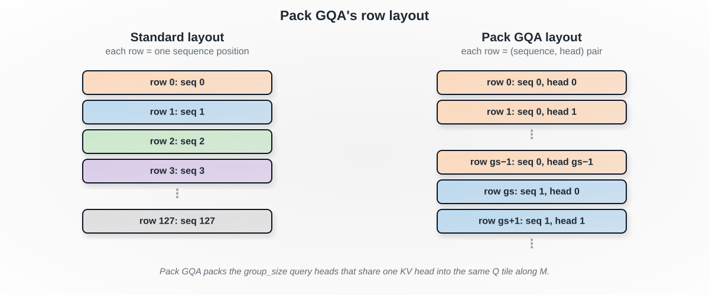
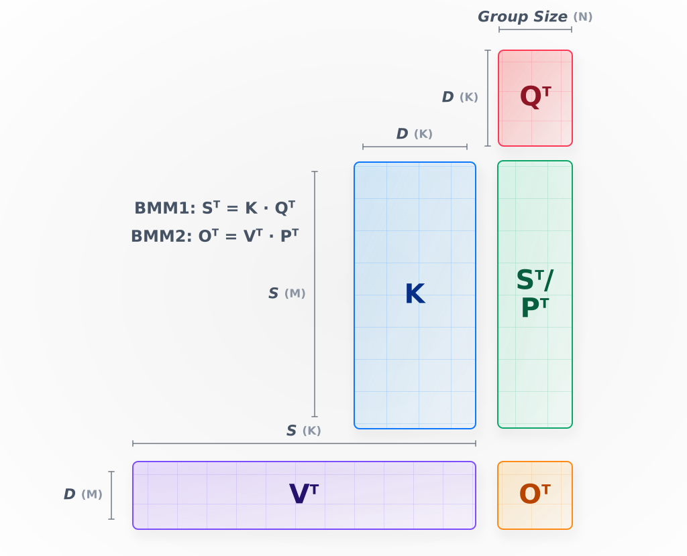
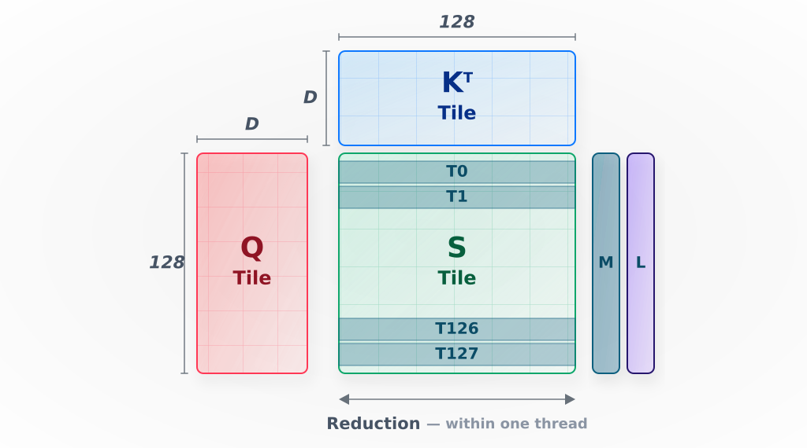
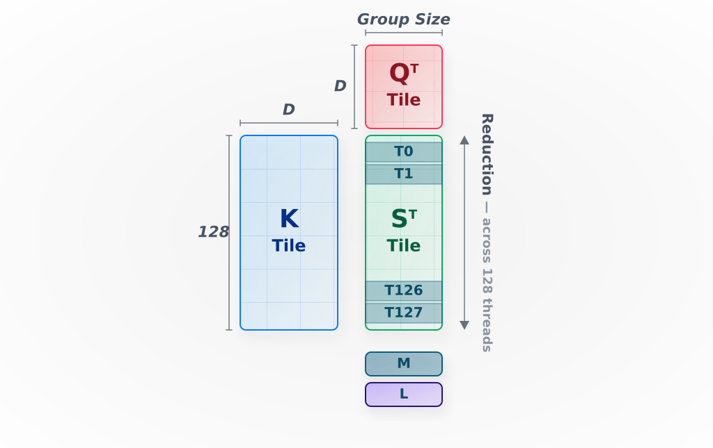
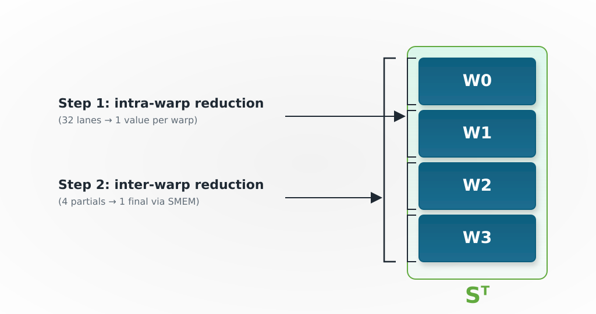

# Efficient Blackwell Attention: Decode Phase

This document describes how a decode-phase attention kernel diverges from a prefill kernel on
Blackwell, and what that divergence means for kernel design. Specializing the kernel to the decode
shape improves memory throughput on GB200 from **60% to ~94% of peak HBM bandwidth** (4.8 TB/s to
7.5 TB/s at `q_seqlen = 1`).

## 1. Motivation

LLM inference happens in two **different** phases that run back to back. (1) **Prefill** runs once at the start of a request: the model ingests the entire input prompt in a single forward pass and produces the initial KV cache. (2) **Decode** then runs repeatedly, one step per generated tokens, with each step appending its newly computed `K` and `V` to the cache.

Each attention layer takes three inputs: `Q`, `K`, and `V`. Their shapes differ by phase.

**Prefill**:

```text
Q: (S, H_Q,  D_QK)
K: (S, H_KV, D_QK)
V: (S, H_KV, D_V)
```

`S` is the sequence length (a few thousand to millions of tokens on long-context models), `H_Q` is the number of query heads, and `H_KV` is the number of KV heads.
Under [GQA](https://arxiv.org/pdf/2305.13245), `H_Q % H_KV == 0`; MHA (`H_Q == H_KV`) and MQA (`H_KV == 1`) are special cases of it.
`D_QK` is the per-head dimension shared by `Q` and `K`, and `D_V` is the per-head dimension of `V`. 
Typically `D_QK = D_V`, but not always.
For example, DeepSeek's MLA concatenates a RoPE dimension onto the QK head dim, so `D_QK > D_V`.
Since `S` is usually large, prefill is in the compute bound regime.



**Decode** (`q_seqlen = 1`, or a few tokens with speculative decoding or MTP):

```text
Q: (1, H_Q,  D_QK)
K: (S, H_KV, D_QK)
V: (S, H_KV, D_V)
```

The math is the same as prefill; the shapes are not. (Here `S` is the total context length seen so far, which is prompt + already generated tokens.)

, while K and V span the entire context so far.")

The bottleneck for an attention kernel depends on (1) the batch/head level parallelism, (2) the query length, and (3) the KV length:

| Phase   | Batch x H_KV | Q_seqlen | KV_seqlen | Bottleneck    |
|:---:|:---:|:---:|:---:|:---:|
| Prefill | High | Long  | Long  | Compute bound |
| Prefill | Low  | Long  | Long  | Compute bound |
| Decode  | High | Small | Small | DRAM bound    |
| Decode  | High | Small | Long  | DRAM bound    |
| Decode  | Low  | Small | Small | Latency bound |
| Decode  | Low  | Small | Long  | DRAM bound[^split-kv] |

A single attention kernel that handles all of these is convenient, but it leaves performance on the table.
This document focuses on the **DRAM bound decode cases**, high `Batch x H_KV`, where there is enough work in flight to fill the SMs.

Concretely, on GB200 with `q_seqlen = 1`, [**FlashAttention-4 (FA4)**](https://github.com/Dao-AILab/flash-attention), a widely used open-source attention kernel, achieves around **4.8 TB/s** of effective HBM bandwidth.
Against the ~8.0 TB/s peak bandwidth that is roughly 60%: not bad, but not great.
Even without any fancy optimizations, just a kernel (1) designed specifically for the decode shape, (2) a better pipeline schedule that overlaps work across different hardware units (e.g., Tensor Cores and the CUDA Cores / SFU), and (3) the right choice of PTX instructions, reaches around **7.5 TB/s**, ~94% of peak bandwidth.
Closing that gap is the entire point of this document.

## 2. Background

This document assumes familiarity with the FlashAttention algorithm. If FlashAttention is unfamiliar, the [original FlashAttention paper](https://arxiv.org/pdf/2205.14135) is the best place to start before reading further.

This section covers (1) the prefill kernel's design on Blackwell, and (2) why that design is not a perfect fit for decode.

### 2.1 Prefill Kernel Design

In the Blackwell prefill kernel, each CTA owns **two Q blocks**. Each Q block holds `tile_m` query rows, where `tile_m = 128` is chosen to match the M dimension that Blackwell's Tensor Core instruction [`tcgen05.mma`](https://docs.nvidia.com/cuda/parallel-thread-execution/index.html#tcgen05-matrix-shape) supports[^2cta-mma]. So a single CTA covers `2 x 128 = 256` Q rows and, for each of them, walks the corresponding KV sequence one `BLOCK_N`-wide block at a time.

, spanning 2 x tile_m query rows.")

One CTA owns two Q blocks (`Q_0`, `Q_1`), spanning `2 x tile_m` query rows. Both blocks stream the same `K` and `V` chunks, produce their own `S`/`P`, and accumulate into their own output blocks, `O`.

The reason each CTA gets two Q blocks is to enable pipelining: while the MMA warp runs a GEMM on one Q block, the softmax warp runs on the other. The full pipeline schedule is described in Section 2.1.2.

#### 2.1.1 Warp specialization structure

The CTA runs **16 warps**, split across five distinct roles (1 warpgroup = 4 warps).

| Role | Count | Description | Key PTX instructions |
|:---|:---|:---|:---|
| **Load warp** | 1 warp | TMA loads of `Q`, `K`, `V` from GMEM into SMEM | `cp.async.bulk.tensor` |
| **MMA warp** | 1 warp | Issues BMM1 (`S = Q · K^T`) and BMM2 (`O += P · V`); results to TMEM | `tcgen05.mma` |
| **Epilogue warp** | 1 warp | TMA store SMEM to GMEM | `cp.async.bulk.tensor` |
| **Softmax WGs** | 2 WGs (8 warps) | One WG per Q block. Per KV step: (1) update `m` (row max), (2) `alpha = exp2(m_old - m_new)`, (3) `P = exp2(S - m_new)`, (4) update `L` (row sum) | `tcgen05.ld`, `max.f32`[^rowmax-gb300], `fma.rn.f32x2`, `ex2.approx.f32`, `add.f32x2`, `cvt.rn.f16x2.f32`, `tcgen05.st` |
| **Correction WG** | 1 WG (4 warps) | Per KV step: `O <- alpha * O`. End of KV loop: `O <- O / L`, stored into SMEM | `tcgen05.ld`, `mul.f32x2`, `tcgen05.st`, `st.shared` |

That accounts for `1 + 1 + 8 + 4 + 1 = 15` warps. The 16th warp is left idle in this design.

The kernel uses two softmax warpgroups because softmax is often the bottleneck. The `exp2` is the expensive part: SFU throughput is far below the Tensor Core's. Worse, `exp2` is not all softmax does — every KV step also needs a row max and a row sum. With a single softmax warpgroup, unless the head dimension is large enough, the MMA warp would often have to wait for softmax to finish[^sfu-throughput].
So softmax gets two warpgroups, one per Q block.

#### 2.1.2 Pipeline structure

The two Q blocks are interleaved so that the MMA of one block (Q0) overlaps with softmax and correction on the other (Q1). The schedule below follows the prefill pipeline described in the [FA4 paper](https://arxiv.org/pdf/2603.05451).



The Tensor Core row is split into Q0 / Q1 lanes for clarity; a single MMA warp issues all GEMMs. Red arrows show data dependencies: each `S` must finish before its softmax `P`, and each `P` must finish before the BMM2 (`O = P · V`) that consumes it.

**Prologue.** The load warp loads `K_0`, `Q_0`, `Q_1`, `V_0`. The MMA warp issues `S_{0,0} = Q_0 · K_0^T` then `S_{1,0} = Q_1 · K_0^T`. The softmax WGs then produce `P_{0,0}` and `P_{1,0}`, so the mainloop's first BMM2 has an operand to consume.

**Mainloop.** Per KV index `n` (`n = 0, 1, ..., N-1`):

1. **Load warp** loads `K_{n+1}` then `V_{n+1}` into SMEM from GMEM.
2. **MMA warp** issues four GEMMs back to back:
   - `O_0 += P_{0,n} · V_n` (BMM2, stage 0)
   - `S_{0,n+1} = Q_0 · K_{n+1}^T` (BMM1, stage 0)
   - `O_1 += P_{1,n} · V_n` (BMM2, stage 1)
   - `S_{1,n+1} = Q_1 · K_{n+1}^T` (BMM1, stage 1)
3. **Softmax WG** loads `S_{i,n+1}` from TMEM to RMEM, then computes `P_{i,n+1}`, the row max, and the row sum.
4. **Correction WG** rescales `O_i` by `alpha_i`.

**Epilogue.** The MMA warp does the final BMM2 for both Q blocks.
The correction WG normalizes `O <- O / L` and writes it to SMEM.
The epilogue warp issues the TMA store.

### 2.2 Why the prefill pipeline does not fit at `q_seqlen = 1`

The prefill pipeline assumes a long Q sequence, so that **both Q blocks hold mostly valid query rows**.

Decode has `q_seqlen = 1`, so this does not hold. Even using 64 as the M of `tcgen05.mma` (the smallest supported), the two Q blocks per CTA add up to 128 rows in total — only 1 of every 128 is real.

## 3. Decode Attention Kernel

This section walks through the changes from prefill to decode, step by step.

### 3.1 One Q tile instead of two: no overlap

In prefill, the two Q blocks per CTA enable overlap: while the MMA warp runs a GEMM on one Q block, the softmax warp runs on the other.
Decode cannot have two Q tiles. With `q_seqlen = 1`, there is only one valid query row, so the second block would be all padding.
Therefore the kernel can run with just one Q tile per CTA. M utilization improves by 2x; however, with only one valid Q tile, the prefill pipeline's overlap no longer works — the MMA warp has to wait for softmax to finish before issuing the next MMA.



### 3.2 Better pipeline (1-K peeling)

In Section 3.1 the MMA warp had no other Q block to work on while softmax was running. This can be fixed by peeling K one step ahead: at each KV iteration, the MMA issues BMM1 for the next KV step while softmax runs on the current step. This requires changing the load order from the prefill pattern (`Q, K_0, V_0, K_1, V_1, ...`) to

```text
Q, K_0, K_1, V_0, K_2, V_1, K_3, V_2, ..., K_N, V_{N-1}, V_N
```

At each KV index `n`, the MMA warp issues two GEMMs back-to-back, in parallel with softmax on `S_n`:

- `O += P_{n-1} · V_{n-1}` (BMM2 of the *previous* KV index), and
- `S_{n+1} = Q · K_{n+1}^T` (BMM1 of the *next* KV index).



`S0`/`S1` and `P0`/`P1` in the figure are buffer indices, since the peel requires double-buffered `S` / `P`.

M utilization stays at `1/MMA_M` — still mostly wasted — but MMAs and softmax now overlap.

### 3.3 Pack GQA

In GQA, each KV head is shared by `group_size = H_Q / H_KV` query heads.

Pack GQA stacks the `group_size` query heads that share a KV head into the same Q tile along the M axis. From the MMA's perspective, Q's effective row count is `group_size` times larger.



In Pack GQA, each row holds a (sequence, head) pair: the `group_size` query heads sharing one KV head are packed into consecutive rows along M.

This works for **both prefill and decode**, but it is **critical for decode**. With `q_seqlen = 1`, MMA M utilization is stuck at `1/MMA_M` (where `MMA_M` is 64 or 128). After Pack GQA, `group_size` of the M rows carry valid Q heads, so utilization becomes `group_size / MMA_M`.

This brings two gains:

- **Higher MMA M utilization**: `1/MMA_M` becomes `group_size/MMA_M`, a `group_size`x improvement.
- **Lower L2 traffic**: each KV head is loaded once per group of query heads, not once per query head.

`group_size/MMA_M` is still mostly padding along M for typical group sizes. Section 3.4 closes that.

### 3.4 Swap-AB

#### 3.4.1 Swap-AB

Even after Pack GQA, only `group_size` of the MMA tile's `MMA_M` rows hold valid Q. The shapes `tcgen05.mma` supports are listed in the [PTX ISA](https://docs.nvidia.com/cuda/parallel-thread-execution/#tcgen05-matrix-shape).

For `kind::f16`, CTA Group 1, dense, the smallest M tile is **64** (the prefill kernel uses `MMA_M = 128`), while N starts at **8** and grows in steps of **8**. This is the key observation for the decode kernel: N's minimum tile is far smaller than M's, small enough to host `q_rows`. For `group_size = 8`, N's minimum of 8 fits exactly.

The trick is to swap Q and K: compute `S^T = K · Q^T` instead of `S = Q · K^T`:

```text
BMM1 with Pack GQA only:   S    = Q · K^T     M = q_rows ,  N = BLOCK_N,  K = D
BMM1 + swap-AB:            S^T  = K · Q^T     M = BLOCK_N,  N = q_rows ,  K = D
```

Now `K` is the A operand with `M = BLOCK_N` fully filled, and `Q` is the B operand with `N = q_rows`. For `group_size = 8`, that is exactly the smallest supported N. Both dimensions of the MMA tile are full.

The same swap applies to BMM2: `O = P · V` becomes `O^T = V^T · P^T`:

```text
BMM2 with Pack GQA only:   O    = P · V       M = q_rows,  N = D,       K = BLOCK_N
BMM2 + swap-AB:            O^T  = V^T · P^T   M = D,       N = q_rows,  K = BLOCK_N
```

The figure below summarizes the swap:



Both BMMs swap their A and B operands so that the small `q_rows` axis lands on N, where the MMA supports a minimum tile of 8.

#### 3.4.2 Softmax now needs cross-thread sync

The swap has a cost in softmax. Softmax reads `S` out of TMEM with `tcgen05.ld.sync.aligned.32x32b.x32.b32`. With the `32x32b` fragment shape, thread `T_x` reads row `x` of the TMEM tile into its own registers; the [PTX ISA](https://docs.nvidia.com/cuda/parallel-thread-execution/#tcgen05-mma-fragment-3232b) gives the full thread-to-row mapping.

`S` is the result of an MMA, so it lives in TMEM, as do `P` and `O` in the prefill kernel. There the tile holds `S` in its natural layout, so each thread `T_x` owns row `x` of `S` across its registers. Softmax reductions are per-row, so they stay per-thread:



Row values all live in one thread, so row-max and row-sum stay in-register — no cross-thread communication.

After swap-AB, the tile holds `S^T`. Each row of `S` is now spread along the M axis of the tile, with one element per thread. The softmax row-reduction now runs across M — with `BLOCK_N = 128`, a 128-thread combine across the warpgroup:



The 128-thread reduction happens in two steps: a warp-level reduction inside each of the 4 warps, then an inter-warp combine through SMEM.



**Step 1:** each of the 4 warps reduces its 32 lanes down to 1 partial value. **Step 2:** the 4 partials are combined into 1 final value through SMEM.

##### 3.4.2.1 Col max of `S^T` (a row max of `S`)

For each q-row `j` in `[0, group_size)`, the warpgroup reduces a 128-element column of `S^T` down to one max. This runs in two steps:

1. **Within-warp.** Each warp `w` in `{0, 1, 2, 3}` reduces over its 32 lanes with one `redux.sync.max.f32`. The instruction reduces 32 lanes and broadcasts the warp-max to every lane in a single instruction. Four warps produce four partial maxes.
2. **Inter-warp.** Either (1) one lane per warp writes its partial max to a small SMEM scratch buffer and every lane reads the four values back and combines them, or (2) one lane per warp does an SMEM atomic reduction. Both produce the final `m_new`.

##### 3.4.2.2 Col sum of `S^T` (a row sum of `S`)

Row sum needs the same 128-thread combine as row max, but unlike row max it does not need it every KV step.

`alpha` is a per-q-row scalar that every thread already holds once the row-max combine is done, so the online-softmax update distributes over partial sums: `alpha * L + sum(P^T)` is equal to the sum over threads of `alpha * L_t + sum_t(P^T)`. Each thread therefore keeps its own partial `L_t` in a register, rescales that partial by `alpha`, and adds only the elements it owns. The mainloop does no cross-thread traffic for the row sum at all.

The full combine runs **once**, in the epilogue, just before the `O <- O / L` normalization:

1. **Within-warp.** Each warp `w` in `{0, 1, 2, 3}` reduces its 32 partials with a butterfly: 5 rounds of `shfl.sync.bfly.b32` + `add.f32`.
2. **Inter-warp.** Same as the inter-warp step for row max, but addition instead of max, producing the final `L`.

Row max cannot be deferred this way: `m_new` is needed inside the very iteration that produces it, both to form `alpha` and to compute `P^T = exp2(S^T - m_new)`.

#### 3.4.3 Correction and epilogue

The swap also relocates `P`. In prefill, `P` is BMM2's **A** operand, and `tcgen05.mma` can read A straight out of TMEM — so softmax writes `P` back to TMEM with `tcgen05.st`. After swap-AB, `P^T` is the **B** operand, and B must come from SMEM. Softmax therefore stores `P^T` to SMEM with `st.shared` instead, and `P^T` never enters TMEM at all.

Because BMM2 became `O^T = V^T · P^T`, the output sits in TMEM as `O^T` of shape `(D, group_size)`.
Correction's rescale `O^T <- alpha * O^T` is elementwise, so the transposed layout does not matter.

`O^T` stays in TMEM through every iteration. It is transposed back to `O` once at the end.

## 4. Summary

The full decode inner loop, with all three techniques in place:

```text
Per KV iteration n (steady state):

  Load warp     : K[n+1] and V[n] -> SMEM
  MMA warp      : BMM2: O^T += V[n-1]^T · P^T[n-1]   (previous iter)
                  BMM1: S^T[n+1] <- K[n+1] · Q^T     (peel: next iter)
  Softmax WG    : S^T[n] -> RMEM ; m_new = wg_max ; alpha = exp2(m - m_new)
                  P^T[n] = exp2(S^T[n] - m_new) -> SMEM ; L_t <- alpha*L_t + sum_t(P^T[n])
  Correction WG : O^T -> RMEM ; O^T <- alpha * O^T ; store O^T -> TMEM

  (m_new needs a 128-thread combine every step; L_t stays thread-local)

Epilogue:
  Softmax WG    : L = combine(L_t) over the warpgroup   (butterfly + SMEM, once)
  Correction WG : O^T <- O^T / L  ->  SMEM (transpose on write)
  Epilogue warp : TMA store SMEM -> GMEM
```

Three principles do the work:

1. **Pipeline.** 1-K peel keeps BMM1 one iteration ahead of BMM2 so MMA and softmax can overlap.
2. **Reshape.** Pack GQA + swap-AB fills both MMA dimensions.
3. **Instructions.** The right PTX instructions for softmax and reductions.

Together these improve memory throughput on GB200 at `q_seqlen = 1` from **60% of peak HBM bandwidth
to ~94%** — 4.8 TB/s to 7.5 TB/s against a ~8.0 TB/s peak.

## 5. Limitations

This document covered only the DRAM bound configs, where there is enough work to fill the SMs. It did not cover the optimization techniques for latency bound scenarios (small batch or small `H_KV`).

The latency bound path needs more optimizations beyond the kernel in Section 3, such as:

- **Split-KV.** Shard the KV sequence across multiple CTAs per `(batch, kv_head)` so there is enough work for the SMs. Each CTA writes a partial output; a post-reduction step combines them with the online-softmax merge.
- **Optimized post-reduction.** With split-KV the merge itself becomes a real cost. Two ways to cut it: (1) PDL (Programmatic Dependent Launch) so the reduction kernel starts as soon as partials are ready, or (2) a single-kernel DSMEM reduction that combines partials through distributed shared memory instead of HBM.
- **Optimized prologue.** Before the first KV load, the kernel has to init mbarriers and read the metadata that says what to load — page indices for a paged KV cache, or sequence length info. These costs are minimized by overlapping those operations with each other.

[^split-kv]: With split-KV, a low `Batch x H_KV` decode case can shard the long KV sequence across multiple CTAs and expose enough parallelism to become DRAM bound. This document does not cover this path.

[^2cta-mma]: `tcgen05.mma` has a 2-CTA variant where two CTAs cooperate on one MMA with M=256, letting a CTA-pair handle two `tile_m = 256` Q blocks. This document does not cover that mode.

[^sfu-throughput]: Per Q block per KV step:

    - BMM1 (`S = Q · K^T`): `2 x 128 x 128 x D_QK` ops
    - BMM2 (`O += P · V`): `2 x 128 x 128 x D_V` ops
    - Softmax: `128 x 128 = 16384` `exp2` ops

    MMA work scales with `D_QK + D_V`; the `exp2` count does not. So whether one softmax warpgroup can keep up with the MMA is set by `D_QK + D_V`.

[^rowmax-gb300]: GB300 adds a new TMEM load variant that fuses the row-max reduction, removing most of the explicit max instructions. This document does not cover it.

# Copyright

Copyright (c) 2026 NVIDIA CORPORATION & AFFILIATES. All rights reserved.
SPDX-License-Identifier: BSD-3-Clause

```text
  Redistribution and use in source and binary forms, with or without
  modification, are permitted provided that the following conditions are met:

  1. Redistributions of source code must retain the above copyright notice, this
  list of conditions and the following disclaimer.

  2. Redistributions in binary form must reproduce the above copyright notice,
  this list of conditions and the following disclaimer in the documentation
  and/or other materials provided with the distribution.

  3. Neither the name of the copyright holder nor the names of its
  contributors may be used to endorse or promote products derived from
  this software without specific prior written permission.

  THIS SOFTWARE IS PROVIDED BY THE COPYRIGHT HOLDERS AND CONTRIBUTORS "AS IS"
  AND ANY EXPRESS OR IMPLIED WARRANTIES, INCLUDING, BUT NOT LIMITED TO, THE
  IMPLIED WARRANTIES OF MERCHANTABILITY AND FITNESS FOR A PARTICULAR PURPOSE ARE
  DISCLAIMED. IN NO EVENT SHALL THE COPYRIGHT HOLDER OR CONTRIBUTORS BE LIABLE
  FOR ANY DIRECT, INDIRECT, INCIDENTAL, SPECIAL, EXEMPLARY, OR CONSEQUENTIAL
  DAMAGES (INCLUDING, BUT NOT LIMITED TO, PROCUREMENT OF SUBSTITUTE GOODS OR
  SERVICES; LOSS OF USE, DATA, OR PROFITS; OR BUSINESS INTERRUPTION) HOWEVER
  CAUSED AND ON ANY THEORY OF LIABILITY, WHETHER IN CONTRACT, STRICT LIABILITY,
  OR TORT (INCLUDING NEGLIGENCE OR OTHERWISE) ARISING IN ANY WAY OUT OF THE USE
  OF THIS SOFTWARE, EVEN IF ADVISED OF THE POSSIBILITY OF SUCH DAMAGE.
```
